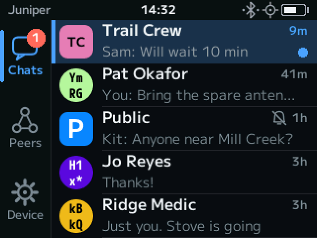

\[ [`umsh.dev`](https://umsh.dev)
| [Protocol Book](https://darconeous.github.io/umsh/docs/protocol/)
| [Rustdocs](https://darconeous.github.io/umsh/docs/rust/)
\]

**UMSH** is an experimental, LoRa-oriented mesh protocol designed from the ground up with strong cryptography, clean layer separation, and strict bandwidth discipline. The primary use case it enables is decentralized, wide-area text chat and location/sensor reporting.



*Replying to a message on a T-Deck communicator.*

Originally intended as a proposal for a "[MeshCore](https://github.com/meshcore-dev/MeshCore) 2.0", UMSH grew out of a simple question: what would a cryptographically addressed LoRa mesh protocol look like with proper security and clean architecture as primary design goals? Inspired by [MeshCore](https://github.com/meshcore-dev/MeshCore), it started as a thought experiment addressing the [critical shortcomings](https://darconeous.github.io/umsh/docs/protocol/meshcore-comparison.html#cryptography) in that protocol that would practically require backward-incompatible changes to fix. What began as a toy protocol has since been developed into a [comprehensive specification](https://darconeous.github.io/umsh/docs/protocol/), a reference implementation, firmware for a range of nRF52840 and ESP32-S3 boards (including handheld communicators that need no phone), and an iOS app.

> [!NOTE]
> Practically all of the content in this repository was written with the assistance of an LLM.
> For more details, see [`docs/AI.md`](docs/AI.md). This project would not exist without
> LLM coding assistance, as the amount of work required to write this by hand would be too much
> for me to dedicate to unpaid work.
>
> It has taken considerable effort to get it to this point. If you'd like to tag along
> for the ride and see where this ends up going, follow the project on GitHub to see
> updates. I'd also love to hear your feedback!

---

## What makes UMSH interesting

### Public-key node identity

Nodes are identified by Ed25519 public keys—the key is simultaneously the network address
and the cryptographic credential, with no numeric IDs, no registration, and no central
authority. On the wire, compact 3-byte hints keep per-packet overhead small; the full key
appears only when needed (first contact, ephemeral identities).

### Cryptography suited to mesh constraints

UMSH uses AES-SIV (RFC 5297) with AES-256, in which the authentication tag serves as the
encryption nonce. If a frame counter is accidentally reused (e.g., after a reboot with no
persistent storage), the only consequence is detectable plaintext repetition—confidentiality
and authenticity are otherwise preserved. Replay protection uses a monotonic counter rather
than timestamps. Keys are derived via HKDF with domain separation, producing independent
encryption and authentication keys from each ECDH shared secret.

For forward secrecy, two nodes can open a
[PFS session](https://darconeous.github.io/umsh/docs/protocol/security.html#perfect-forward-secrecy-sessions):
a two-message handshake exchanges ephemeral node addresses, whose private keys are erased
when the session ends. Session packets are smaller than ordinary unicast, since keys that
will be erased justify a 4-byte MIC.

### Channel keys serve two roles

A shared channel key enables symmetric-key multicast. It also enables *blind unicast*: a
unicast packet that resembles multicast traffic on the wire, concealing sender and recipient
identities from anyone without the key. The payload is protected by a key derived from both
the channel key and the pairwise shared secret, so only the intended recipient can read it.

### Composable routing

Source routes, flood hop counts, and trace-route accumulation are independent packet options
that can be freely combined. A packet can source-route to a specific region and then flood
locally from there. Path discovery is not a separate operation—it falls out of normal packet
exchange when the trace-route option is present.

### Minimal mandatory state

Basic operation requires only a node's own keypair and configured channel keys—no path
tables, no clock synchronization. The Rust implementation is `no_std` (although `alloc` is
still required at this point), and every packet fits in a single LoRa frame.

### Built to be inspected

The wire format was designed alongside its tooling. A Wireshark dissector decodes and
decrypts UMSH frames, `umshctl` installs as a Wireshark capture interface so a radio in the
mesh is a double-click away, and
[ULCP](https://darconeous.github.io/umsh/docs/protocol/ulcp.html), the control protocol
between a radio and its host, is captured and dissected on the same footing as the radio
traffic.

---

## What's in this repository

| Path | Description |
|---|---|
| [`docs/protocol/`](docs/protocol/) | Full mdBook specification for the protocol, including comparisons and test vectors |
| [`docs/hardware/`](docs/hardware/) | Per-board hardware references—pin maps, power, radio and display wiring |
| [`crates/`](crates/) | Layered `no_std` Rust library crates implementing the protocol stack, plus board support and device interfaces |
| [`umsh/`](umsh/) | Integration crate with runtime adapters and runnable examples |
| [`firmware/`](firmware/) | nRF52840 device firmware—one shipping image per board—and the simulator communicator |
| [`firmware-esp32/`](firmware-esp32/) | Separate workspace for Espressif boards, which need the Xtensa toolchain |
| [`apps/ios/`](apps/ios/) | SwiftUI iOS application |
| [`packages/UMSHMobileCore`](packages/) | UniFFI Swift package wrapping the Rust core for the app |
| [`tools/`](tools/) | Host tools—the `umshctl` radio tool, the browser-based ULCP debugger, the region-database compiler, and the UniFFI binding generator |
| [`regions/`](regions/) | Source data for the geographic region database |
| [`dissectors/`](dissectors/) | Wireshark Lua dissector, fixtures, and dissector-specific tests |
| [`fuzz/`](fuzz/) | Coverage-guided fuzzers for UMSH and ULCP |
| [`scripts/`](scripts/) | Firmware image, flashing, and release scripts |
| [`site/`](site/) | Sources for [umsh.dev](https://umsh.dev) |

The [`docs/protocol/`](docs/protocol/) directory holds the specification as an
[mdBook](https://rust-lang.github.io/mdBook/): the MAC layer, all packet types, cryptographic
constructions, routing, application protocols, and appendices including protocol comparisons
and test vectors. [`crates/`](crates/) implements it as a set of layered `no_std` libraries,
from primitive types (`umsh-core`) up through cryptography, the MAC layer, node state, and
application protocols; [`umsh/`](umsh/) bundles those together and adds Tokio and Embassy
runtime adapters. Rendered copies of both are published at
<https://darconeous.github.io/umsh/docs/protocol/> and
<https://darconeous.github.io/umsh/docs/rust/>.

---

## Getting started

### Try it

You don't need to build anything to try UMSH:

- **Flash a radio from your browser.** The [web flasher](https://umsh.dev/flasher/) installs
  the latest [firmware release](https://github.com/darconeous/umsh/releases) over USB.
  [umsh.dev/hardware](https://umsh.dev/hardware/) lists the supported boards and what each is
  good for.
- **Pair it with the iOS app.** The public beta is on
  [TestFlight](https://testflight.apple.com/join/4xsdZ8pg).
- **Or skip the phone.** The LilyGO T-Deck and T-LoRa Pager are communicators: keyboard
  handhelds that send and receive messages on their own.

### What you need to build

A Rust toolchain and Python 3. Espressif boards also need their own compiler, since Xtensa
chips need a Rust fork rustup does not carry. Install it once per machine:

```sh
cargo install espup espflash && espup install
```

Host builds and tests come from the workspace root and deliberately skip `firmware/*`:

```sh
cargo test
```

### Install the host tools

```sh
make install-umshctl
```

That is `cargo install --path tools/umshctl`, so `umshctl` lands in `~/.cargo/bin`.
The Wireshark integration has its own targets, covered below.

### Flash a board

| Board | MCU | Flash with |
|---|---|---|
| Seeed SenseCAP T1000-E | nRF52840 | `make flash-t1000e` |
| LilyGO T-Echo | nRF52840 | `make flash-techo` |
| SenseCAP Solar Node P1 / P1-Pro | nRF52840 | `make flash-sensecap-solar` |
| Seeed Wio Tracker L1 / L1 Pro | nRF52840 | `make flash-wio-tracker-l1` |
| Seeed XIAO nRF52840 + Wio-SX1262 | nRF52840 | `make flash-xiao-nrf52` |
| Heltec WiFi LoRa 32 V3 | ESP32-S3 | `make flash-heltec-v3` |
| LilyGO T-Beam Supreme (SX1262) | ESP32-S3 | `make flash-tbeam-supreme` |
| Seeed XIAO ESP32S3 + Wio-SX1262 | ESP32-S3 | `make flash-xiao-esp32s3` |
| LilyGO T-LoRa Pager (SX1262 or LR1121) | ESP32-S3 | `make flash-tlora-pager` |
| LilyGO T-Deck / T-Deck Plus | ESP32-S3 | `make flash-tdeck` |

The Espressif `make` targets check for the Xtensa toolchain first and say what to run, so a
machine without it fails before the build rather than inside it
([firmware-esp32/README.md](firmware-esp32/README.md)).

There is **one shipping image per board**: a repeater and a phone companion are the same
firmware holding different configuration, applied afterwards over BLE or USB. Flash through
the Makefile rather than invoking cargo and the image converters by hand—nRF52840 firmware
links only in release mode, and each image needs its board's UF2 base address and family ID,
both of which fail silently when wrong.

The board must be in DFU mode first, and how you get there differs per board; the
[flashing page on umsh.dev](https://umsh.dev/flasher/) and
[`docs/hardware/`](docs/hardware/) cover each one. Board architecture and the recipe for
adding a new board are in [docs/firmware-architecture.md](docs/firmware-architecture.md).

The T-Deck's keyboard has an ESP32-C3 of its own. Its stock firmware works, and UMSH's
replacement more than doubles the T-Deck's standby time; flashing it takes a 3.3 V USB-UART
adapter. See [docs/tdeck-keyboard-firmware.md](docs/tdeck-keyboard-firmware.md) and
`make flash-tdeck-keyboard`.

### Talk to a radio with `umshctl`

`umshctl` is the host tool for a UMSH radio over BLE or USB serial: inspection, device
identity, persistence, pairing, radio configuration, and packet capture. Borrowing the
attached radio, it is also a node in its own right—it administers other devices over the
mesh, and sends and receives text messages under its own identity. It attaches
administratively, using the non-resetting handshake, so pointing it at an autonomously
operating board never disturbs that board—only the command you give changes anything.

Given a command it runs that command and exits:

```sh
umshctl --ble="UMSH T-Echo" info
umshctl --port /dev/cu.usbmodem101 phy on
```

Given none, it opens a shell against a single attachment—worth a great deal over BLE, where
every fresh attach costs a discovery pass plus a handshake:

```
$ umshctl
discovered: UMSH T-Echo
attached: UMSH T-Echo (ble) device=techo/0.1 boot_status=RESET_POWER_ON
umshctl—`help` lists commands, `exit` leaves.
UMSH T-Echo (ble)> repeater on
repeater on (on-board node forwards overheard frames)
saved: changes persist across reboots
UMSH T-Echo (ble)> ble-scan
UMSH T-Echo (ble)> connect 2
UMSH T-1000E (ble)> exit
```

`ble-scan` finds *radios to attach this tool to*; `discover` finds *nodes out on the mesh*,
by asking everything in earshot to identify itself and then listening for the answers:

```sh
umshctl discover
umshctl discover --role repeater --timeout 60
umshctl discover --passive
```

With no connection flag the tool finds a radio itself over BLE: the saved default first
(`default set`), then a two-second scan, offering a numbered choice when several answer. Each
board advertises as `UMSH <board>`, such as `UMSH T-Echo`, which is what `--ble=` matches. A
serial port is used only when you name one with `--port` or `UMSHCTL_PORT`—identifying a
device over serial means opening the port and speaking to it, and opening a port can reset or
DFU-trigger hardware that is not a UMSH radio at all.

Mutations persist automatically (`CMD_SAVE`) unless you pass `--no-save`. Tab completion,
`help <command>`, and persistent history come from the same command tree the one-shot grammar
uses.

Before connecting a computer to a board for the first time, put that board into pairing mode—on
boards with a display, from its BLE menu. Pairing is mediated by the operating system;
enter the device's six-digit BLE PIN if prompted. On Linux, enable a `bluetoothctl` agent and
pair/trust the device beforehand if the automatic subscription is rejected. Only one host
session can own a radio at a time, so stop any serial tool and disconnect other BLE centrals
such as nRF Connect first.

### Watch the mesh in Wireshark

```sh
make install-extcap
make install-colorfilters
```

`install-extcap` installs `umshctl` as a Wireshark
[extcap](https://www.wireshark.org/docs/man-pages/extcap.html) interface, along with the Lua
dissector. A radio then shows up in Wireshark's interface list as **UMSH radio** and a
capture is a double-click; from a terminal it is `tshark -i umsh`. Beside it, **UMSH LAN**
(`tshark -i umsh-lan`) captures
[UMSH over IP multicast](https://darconeous.github.io/umsh/docs/protocol/ip-multicast.html).
`install-colorfilters` adds a rule that highlights protocol violations in the packet list.

With keys configured, the dissector verifies MICs and decrypts unicast, multicast, and blind
unicast payloads. Key preferences, capture options, and the pcap formats are in
[dissectors/README.md](dissectors/README.md).

> On macOS, Wireshark.app declares no Bluetooth usage description, so a BLE capture started
> from the Wireshark GUI may be denied by the OS with no prompt. Name a serial port in the
> capture options to sidestep it, or run `tshark -i umsh` from a terminal.

`umshctl capture` is the same capture as a terminal dump, and `--pcap=PATH` writes it to a
file. `--layers=ulcp` or `--layers=both` records the ULCP exchange with the radio as well;
those captures can hold sensitive property values, so check them before sharing.

### Run the iOS app

[`apps/ios/`](apps/ios/) is a SwiftUI application that pairs with a companion radio over BLE
for direct messaging, chat rooms, mapping, and network inspection. It talks to the same Rust
implementation through [`packages/UMSHMobileCore`](packages/), a UniFFI-generated Swift
package that `make ios-mobile-core` builds. See [apps/ios/README.md](apps/ios/README.md).

### Build the documentation

```sh
make docs        # protocol book -> docs/protocol/book/
make docs-serve  # live-reloading preview
make rust-docs   # cargo doc for the whole workspace
```

---

## Developing without hardware

The simulator communicator is a UMSH device in a window: the T-Deck's or T-LoRa Pager's
interface, running the same device code as the firmware, with an IP multicast group for its
radio. It needs SDL2 (`brew install sdl2`, or `libsdl2-dev` on Debian and Ubuntu).

```sh
make run-simulator-communicator NAME=alice
make run-simulator-communicator NAME=bob SIMULATOR_ARGS="--board pager"
```

Each name is its own device, with its own identity and chats, and the two hear each other.
`umshctl --lan` joins the same group with a virtual radio of its own, and Wireshark's
**UMSH LAN** interface captures it:

```sh
umshctl --lan discover
umshctl --lan capture
```

> [!CAUTION]
> Where a radio on your network carries the group onto the air, so does everything the
> simulator sends. Add `--host-local` to `SIMULATOR_ARGS` to keep a test to this computer.

The rest, including the demo mode and headless screenshot scripts, is in
[firmware/host-communicator/README.md](firmware/host-communicator/README.md).

The dissector has its own test suite, which needs no Wireshark:

```sh
lua dissectors/tests/run_tests.lua
```

---

## Region database

A repeater can be told which regions it accepts traffic for. The region database turns a
latitude and longitude into that list, so the iOS app can configure a repeater from where it
stands. Its sources live in [`regions/`](regions/) (see [regions/README.md](regions/README.md)),
and [umsh.dev/regions](https://umsh.dev/regions/) shows the compiled database on a map.

---

## Protocol comparisons

The specification includes detailed point-by-point comparisons with
[MeshCore](https://darconeous.github.io/umsh/docs/protocol/meshcore-comparison.html),
[Meshtastic](https://darconeous.github.io/umsh/docs/protocol/meshtastic-comparison.html),
and [Reticulum](https://darconeous.github.io/umsh/docs/protocol/reticulum-comparison.html).

---

## Contributing

Feedback and issues are welcome on GitHub. Before your first commit, enable the checked-in
pre-commit hook, which rejects commits that aren't rustfmt-clean in either workspace:

```sh
git config core.hooksPath .githooks
```

---

## License

Licensed under either of [Apache License, Version 2.0](LICENSE-APACHE) or
[MIT license](LICENSE-MIT) at your option.
