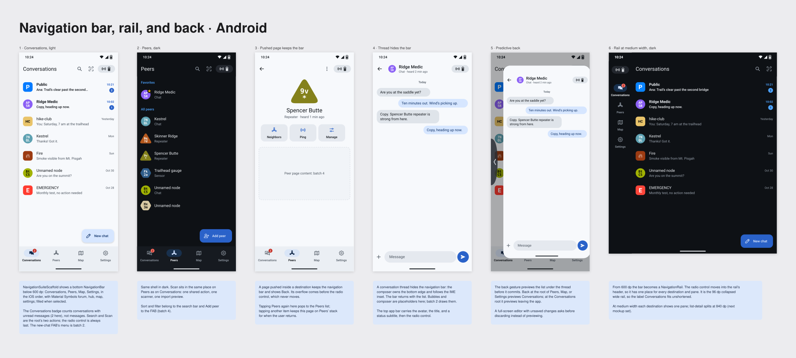
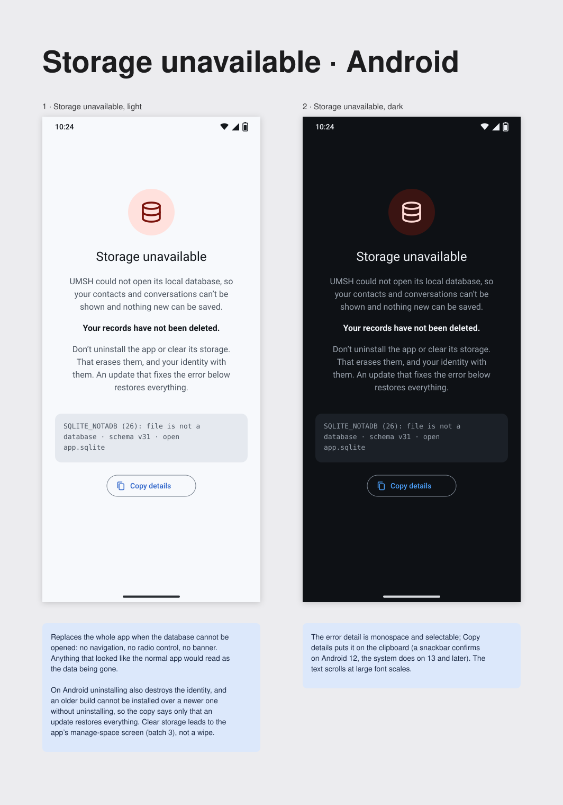

# Android Screen Mockups

The approved mockups are the specification for every Android screen. No Compose
code is written for a screen until its section here is approved, and a built
screen that needs to depart from its approved drawing comes back for review
first, with the drawing updated to match.

Navigation, panes, and app-level chrome are specified in
[Android product structure](product-structure.md). Questions raised while
drawing are in [Android open decisions](open-decisions.md).

## Reading the drawings

- One SVG per feature, boards in a row: the title above each board, notes below.
- Boards are drawn at device size in dp: phones at 412 × 915, tablets at
  1280 × 800, an unfolded foldable at 841 × 701, and a medium-width window at
  701 × 841.
- App chrome uses the fallback color scheme. On a device it takes dynamic color
  from the wallpaper, so hues will differ; roles will not.
- Peer avatars, channel badges, and hint colors are drawn by their canonical
  rules; the sample hints and names are made up, apart from the four canonical
  examples.
- A dashed box marks content that a later batch draws.

## Review status

| Batch | Section | Status |
|---|---|---|
| 1 | [A. Design language](#a-design-language) | Approved 2026-11-17 |
| 1 | [B. Avatars and channel badges](#b-avatars-and-channel-badges) | Approved 2026-11-17 |
| 1 | [C. Navigation bar, rail, and back](#c-navigation-bar-rail-and-back) | Approved 2026-11-17 |
| 1 | [D. Radio control and problem banner](#d-radio-control-and-problem-banner) | Approved 2026-11-17 |
| 1 | [E. List-detail on tablets and foldables](#e-list-detail-on-tablets-and-foldables) | Approved 2026-11-17 |
| 1 | [F. Storage unavailable](#f-storage-unavailable) | Approved 2026-11-17 |
| 2 | Conversations | Not drawn yet |
| 3 | Onboarding and identity | Not drawn yet |
| 4 | Peers and channels | Not drawn yet |
| 5 | Map, radio, and management | Not drawn yet |

# Batch 1: Design language and shell

Batch 1 fixes the visual language every later batch uses, so it is reviewed and
approved before the others are drawn in detail.

## A. Design language

- **Color:** Material 3 dynamic color for chrome. The fallback scheme comes from
  the communicator firmware's palette: its own colors in dark, the same hues
  extrapolated to light. No in-app theme picker.
- **Warning:** one role added to Material's set, the communicator's amber, for
  attention banners.
- **Fixed colors:** peer avatars, channel badges, and sent bubbles never take
  theme color. Public and EMERGENCY follow iOS's light and dark pair. A sent
  bubble is blue, green, or violet by who can read it, the same in every theme.
- **Type:** the system sans at the Material 3 scale; the system monospace for
  addresses, hints, and hex.
- **Shape:** the Material 3 corner scale for containers; the canonical outlines
  for avatars and badges, outside that scale.

## B. Avatars and channel badges

- Drawn from [Peer Identity](../peer-identity-and-sessions.md) and
  [Channel Badges](../channel-badges.md) without restyling: fill, lettering,
  outline, and text color all follow the canonical rules.
- Sizes: 32 dp in a top app bar, 40 dp in a list, 56 dp on a card, 96 dp at the
  top of a page.
- Avatars carry no session state. PFS shows as the violet of a bubble sent under
  a PFS session, as on iOS and the communicator, and in text in the
  conversation's top app bar and on the peer page. Bubbles are drawn in batch 2.

## C. Navigation bar, rail, and back

- Four destinations in the iOS order, as a bottom bar under 600 dp and a rail
  from 600 dp.
- The Conversations item badges the count of conversations with unread
  messages.
- Roots carry **Search** and **Scan**; the radio control is always the last
  thing in the top app bar.
- Threads hide the bar; other pushed pages keep it.
- Back is predictive, and a destination's stack is kept when switching away.

## D. Radio control and problem banner

- The control is a fixed-width tonal pill holding the link glyph and the power
  glyph, so screen actions never shift as the radio's state changes.
- A cached battery reading is dimmed; its age is in the banner and the TalkBack
  label.
- The banner sits in the app-level slot under the top app bar, with one action.
  Bluetooth off and the Nearby devices permission are Android's own banners.

## E. List-detail on tablets and foldables

- `ListDetailPaneScaffold` for Conversations, Peers, and Settings from 840 dp.
- On rail layouts the radio control lives in the rail's header and the banner
  spans the content area, so neither belongs to a pane.
- An empty detail pane shows the destination's icon and one line; Settings
  opens on Your identity instead.

## F. Storage unavailable

- Replaces the whole app: no navigation, radio control, or banner.
- The copy is adapted to Android, where uninstalling also erases the identity
  and an older build cannot be installed over a newer one.
- **Copy details** puts the error on the clipboard.
