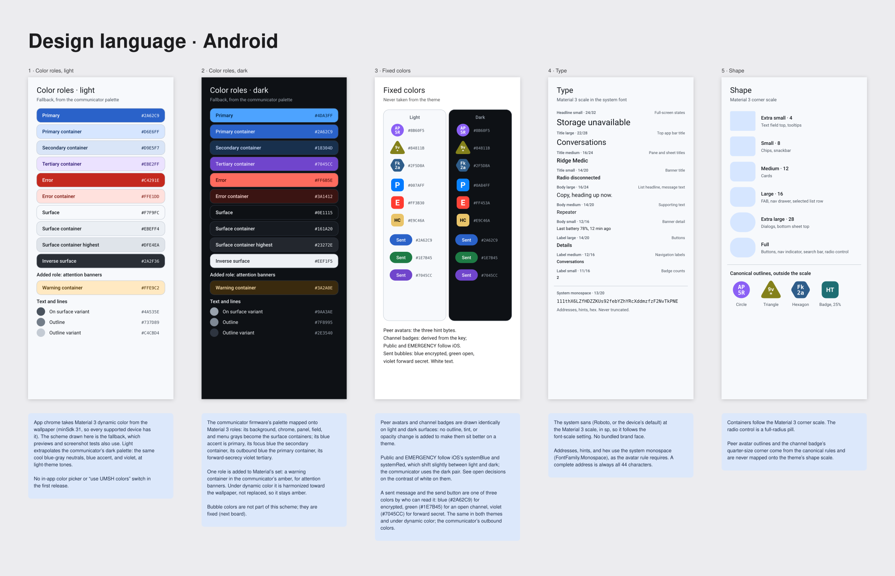
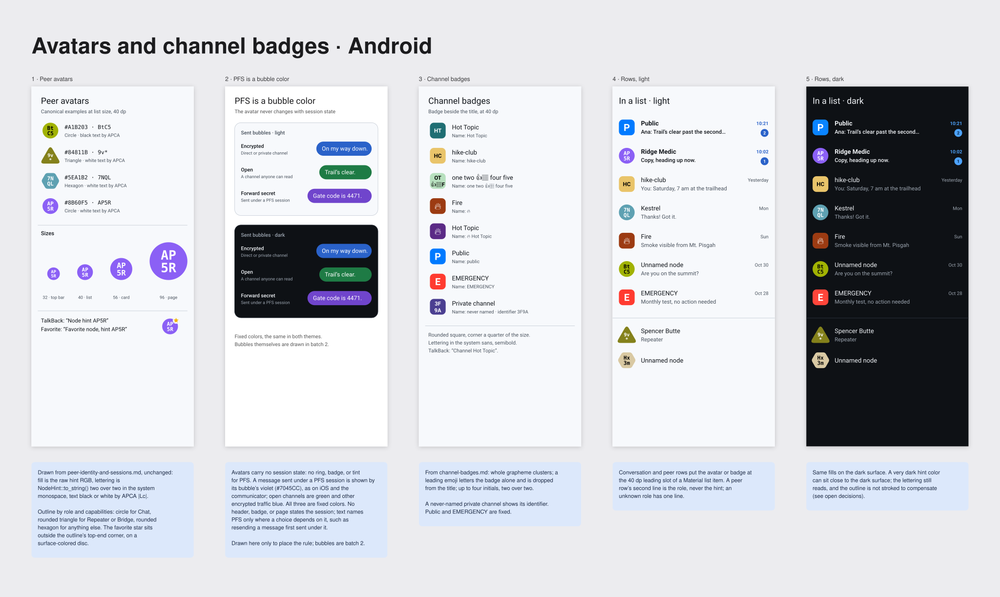
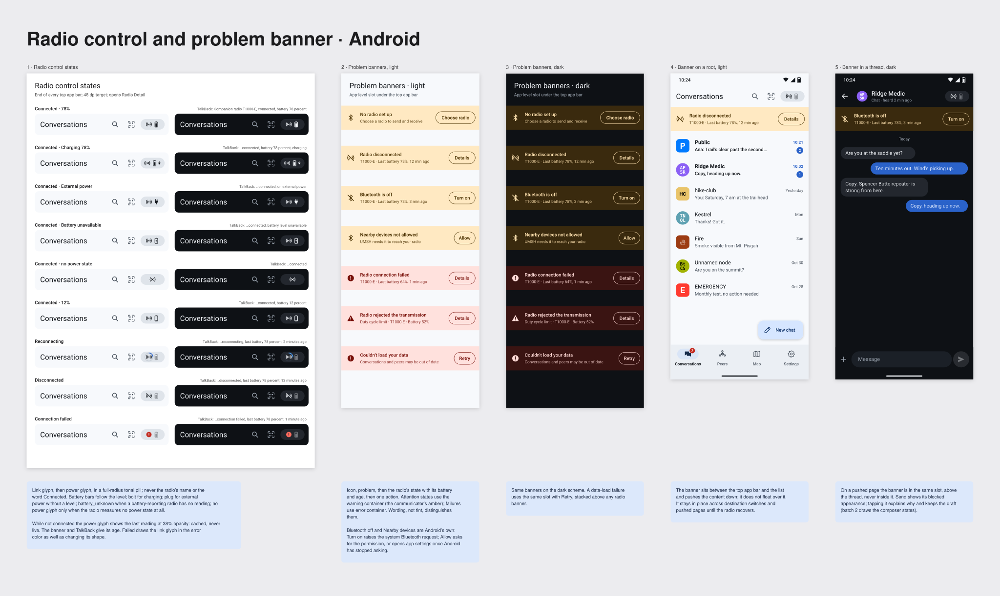
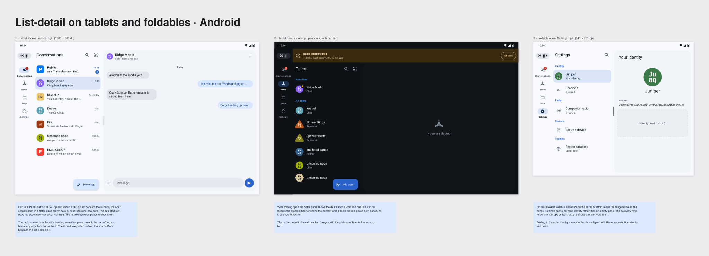
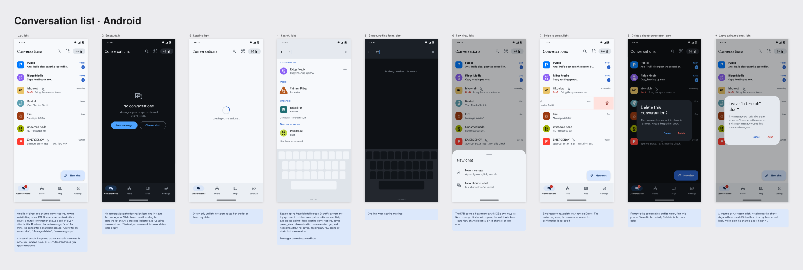
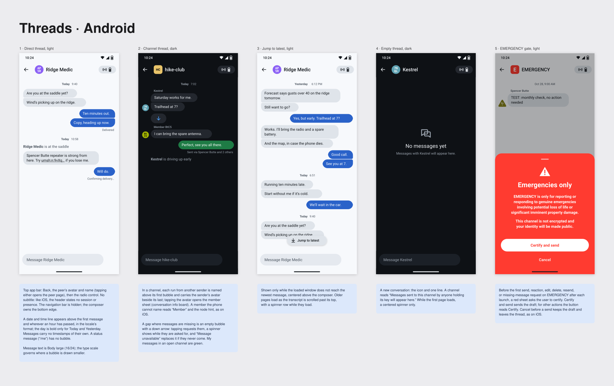
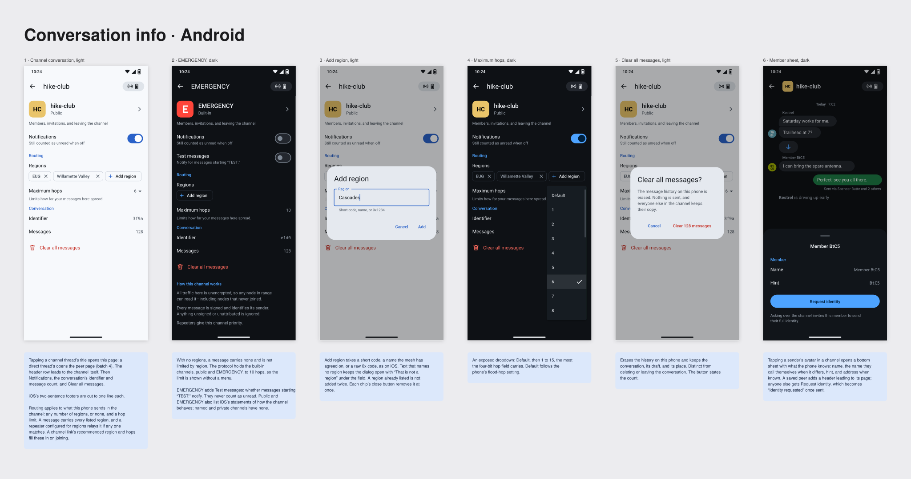
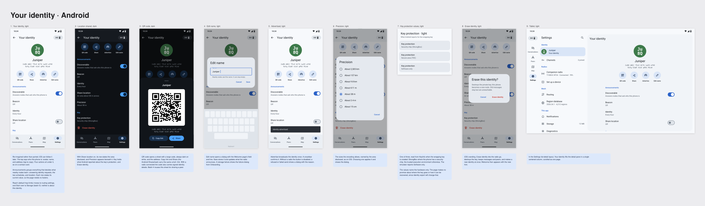
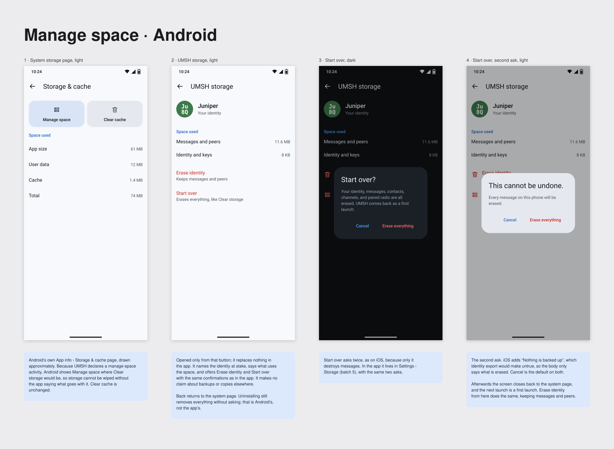

# Android Screen Mockups

The approved mockups are the specification for every Android screen. No Compose
code is written for a screen until its section here is approved, and a built
screen that needs to depart from its approved drawing comes back for review
first, with the drawing updated to match.

Navigation, panes, and app-level chrome are specified in
[Android product structure](product-structure.md). Questions raised while
drawing are in [Android open decisions](open-decisions.md).

## Reading the drawings

- One SVG per feature, boards in a row: the title above each board, notes below.
- Boards are drawn at device size in dp: phones at 412 × 915, tablets at
  1280 × 800, an unfolded foldable at 841 × 701, and a medium-width window at
  701 × 841.
- App chrome uses the fallback color scheme. On a device it takes dynamic color
  from the wallpaper, so hues will differ; roles will not.
- Peer avatars, channel badges, and hint colors are drawn by their canonical
  rules; the sample hints and names are made up, apart from the four canonical
  examples.
- A dashed box marks content that a later batch draws.

## Review status

| Batch | Section | Status |
|---|---|---|
| 1 | [A. Design language](#a-design-language) | Approved 2026-11-17 |
| 1 | [B. Avatars and channel badges](#b-avatars-and-channel-badges) | Approved 2026-11-17 |
| 1 | [C. Navigation bar, rail, and back](#c-navigation-bar-rail-and-back) | Approved 2026-11-17 |
| 1 | [D. Radio control and problem banner](#d-radio-control-and-problem-banner) | Approved 2026-11-17 |
| 1 | [E. List-detail on tablets and foldables](#e-list-detail-on-tablets-and-foldables) | Approved 2026-11-17 |
| 1 | [F. Storage unavailable](#f-storage-unavailable) | Approved 2026-11-17 |
| 2 | [G. Conversation list](#g-conversation-list) | Approved 2026-11-18 |
| 2 | [H. Threads](#h-threads) | Approved 2026-11-18 |
| 2 | [I. Bubbles, delivery, and the message menu](#i-bubbles-delivery-and-the-message-menu) | Approved 2026-11-18 |
| 2 | [J. Replies and reactions](#j-replies-and-reactions) | Approved 2026-11-18 |
| 2 | [K. Composer](#k-composer) | Approved 2026-11-18 |
| 2 | [L. Conversation info](#l-conversation-info) | Approved 2026-11-18 |
| 2 | [M. Notifications](#m-notifications) | Approved 2026-11-18 |
| 2 | [N. Conversations on tablets](#n-conversations-on-tablets) | Approved 2026-11-18 |
| 3 | [O. Onboarding](#o-onboarding) | Approved 2026-11-18 |
| 3 | [P. Adding a radio](#p-adding-a-radio) | Approved 2026-11-18 |
| 3 | [Q. Permissions](#q-permissions) | Approved 2026-11-18 |
| 3 | [R. Your identity](#r-your-identity) | Approved 2026-11-18 |
| 3 | [S. Manage space](#s-manage-space) | Approved 2026-11-18 |
| 4 | Peers and channels | Not drawn yet |
| 5 | Map, radio, and management | Not drawn yet |

# Batch 1: Design language and shell

Batch 1 fixes the visual language every later batch uses, so it is reviewed and
approved before the others are drawn in detail.

## A. Design language

- **Color:** Material 3 dynamic color for chrome. The fallback scheme comes from
  the communicator firmware's palette: its own colors in dark, the same hues
  extrapolated to light. No in-app theme picker.
- **Warning:** one role added to Material's set, the communicator's amber, for
  attention banners.
- **Fixed colors:** peer avatars, channel badges, and sent bubbles never take
  theme color. Public and EMERGENCY follow iOS's light and dark pair. A sent
  bubble is blue, green, or violet by who can read it, the same in every theme.
- **Type:** the system sans at the Material 3 scale; the system monospace for
  addresses, hints, and hex.
- **Shape:** the Material 3 corner scale for containers; the canonical outlines
  for avatars and badges, outside that scale.

## B. Avatars and channel badges

- Drawn from [Peer Identity](../peer-identity-and-sessions.md) and
  [Channel Badges](../channel-badges.md) without restyling: fill, lettering,
  outline, and text color all follow the canonical rules.
- Sizes: 32 dp in a top app bar, 40 dp in a list, 56 dp on a card, 96 dp at the
  top of a page.
- Avatars carry no session state. PFS shows as the violet of a bubble sent under
  a PFS session, as on iOS and the communicator. Text names PFS only where a
  choice depends on it, such as resending a message first sent under it.

## C. Navigation bar, rail, and back

- Four destinations in the iOS order, as a bottom bar under 600 dp and a rail
  from 600 dp.
- The Conversations item badges the count of conversations with unread
  messages.
- Roots carry **Search** and **Scan**; the radio control is always the last
  thing in the top app bar.
- Threads hide the bar; other pushed pages keep it.
- Back is predictive, and a destination's stack is kept when switching away.

## D. Radio control and problem banner

- The control is a fixed-width tonal pill holding the link glyph and the power
  glyph, so screen actions never shift as the radio's state changes.
- A cached battery reading is dimmed; its age is in the banner and the TalkBack
  label.
- The banner sits in the app-level slot under the top app bar, with one action.
  Bluetooth off and the Nearby devices permission are Android's own banners.

## E. List-detail on tablets and foldables

- `ListDetailPaneScaffold` for Conversations, Peers, and Settings from 840 dp.
- On rail layouts the radio control lives in the rail's header and the banner
  spans the content area, so neither belongs to a pane.
- An empty detail pane shows the destination's icon and one line; Settings
  opens on Your identity instead.

## F. Storage unavailable

- Replaces the whole app: no navigation, radio control, or banner.
- The copy is adapted to Android, where uninstalling also erases the identity
  and an older build cannot be installed over a newer one.
- **Copy details** puts the error on the clipboard.

# Batch 2: Conversations

Drawn from the iOS app as built. Where Android departs from it, the board's
notes say so and [open decisions](open-decisions.md#conversations) explain why.

## G. Conversation list

- One list for direct and channel conversations, newest first, with iOS's
  previews: "You:", the channel sender, "Draft:", "Message deleted", and
  "No messages yet".
- **New chat** is an extended FAB opening a sheet with iOS's two ways in.
- Search is full screen and grouped as on iOS. It finds conversations, peers,
  joined channels, and heard nodes, not message text.
- Swiping a row away asks first: Delete for a direct conversation, Leave for a
  channel chat, with iOS's wording.

## H. Threads

- The top app bar holds Back, the avatar and title, and the radio control.
  There is no subtitle, and tapping the title opens conversation info.
- Threads hide the navigation bar; the composer owns the bottom edge.
- A time line appears after an hour's gap. Channel runs are named above and
  carry the sender's avatar.
- A gap of missing messages is a tappable placeholder.
- EMERGENCY asks for certification before the first action after each launch.

## I. Bubbles, delivery, and the message menu

- Received bubbles use the surface container. Mine are the fixed blue, green,
  or violet.
- Runs join with tight corners instead of tails.
- Delivery is a caption in iOS's words, in sentence case. The two failures are
  red, with a retry button.
- Long press shows the reaction bar and a menu. Delete is "Delete for
  everyone".
- Resending a message first sent under PFS offers to send it without forward
  secrecy, the one place text names PFS.
- Message details is a full page with iOS's sections.

## J. Replies and reactions

- Swipe or Reply puts a quote strip in the composer. A sent reply carries its
  quote inside the bubble.
- Tapping a quote jumps to the original and highlights it briefly.
- Reaction chips sit across the bubble's bottom edge. Mine is filled with the
  conversation's color; one that failed is faded.

## K. Composer

- Send appears only when there is text, in the color the message will be
  sent in.
- While the link is transient, Send is dimmed and waits.
- With no radio, the draft stays editable and Send shows blocked. A line above
  the field gives the reason and the way out. Nothing is queued.
- Editing happens in the composer under an "Editing message" strip.

## L. Conversation info

- A channel conversation has its own page, as on iOS; a direct conversation's
  title opens the peer page (batch 4).
- **Routing** limits what this phone sends in the channel: any number of
  regions, or none, and a maximum hop count. Public and EMERGENCY keep the
  protocol's fixed 10 hops.
- **Clear all messages** erases only this phone's history and keeps the
  conversation.
- A channel sender's avatar opens a member sheet with **Request identity**
  for someone not saved.

## M. Notifications

- The boards show Android's own shade and lock screen; the app has no
  notification list of its own.
- Messages use MessagingStyle conversations with the canonical avatar or
  channel badge, and offer Reply and Mark as read.
- The radio's ongoing notification is silent. It always states the power
  state and opens Radio Detail.
- The lock screen version hides sender and content. iOS's failure notices are
  kept word for word.

## N. Conversations on tablets

- The batch 1 list-detail layout with a thread in the detail pane. Its top app
  bar has no Back; the overflow holds conversation info.
- The banner spans both panes, and the composer blocks Send as on a phone.

# Batch 3: Onboarding and identity

Drawn from the iOS app as built, with Android's own pairing, permissions, and
key storage. Where Android departs from it, the board's notes say so and
[open decisions](open-decisions.md#onboarding-and-identity) explain why.

## O. Onboarding

- Two steps, as on iOS: Welcome, then Connect a radio. The identity exists
  before Welcome appears, and Welcome asks only for an optional name.
- **Learn more about UMSH** opens umsh.dev in the browser.
- A failure that won't fix itself, such as the name not saving, opens a dialog
  with what happened and why.
- Connect a radio lists radios in pairing mode with their board photos, as
  iOS's picker does. Tapping one adds it; **Set up later** skips.
- Onboarding ends on Conversations with Public and EMERGENCY joined and
  muted. There is no preset or completion step.

## P. Adding a radio

- Opening Connect a radio asks, only as needed, for Nearby devices and to turn
  on Bluetooth. Tapping a radio raises Android's confirmation for it, then the
  pairing dialog.
- The system dialogs are drawn for order and wording, not exact appearance.

## Q. Permissions

- Each permission is asked by the action that needs it: Nearby devices when
  Connect a radio opens, notifications after the first radio connects, the camera when
  the scanner first opens, precise location when sharing is turned on or a
  device is set to this phone's position.
- Refusing never blocks the rest of the app, and the same button opens
  system settings once Android stops asking.

## R. Your identity

- Re-imagined rather than ported; iOS follows later. The top shows the
  avatar, name, and address, with four actions: **QR code**, **Share**,
  **Advertise**, and **Edit name**.
- **Announcements** holds what nearby nodes learn; **Key** holds the key
  protection Android reported and **Erase identity**.
- Reach and Start over move out of this page (batch 5).

## S. Manage space

- UMSH declares a manage-space screen, so the system storage page offers
  **Manage space** instead of Clear storage.
- The screen offers Erase identity and Start over with their usual
  confirmations, then closes back to the system page. Start over asks twice.
