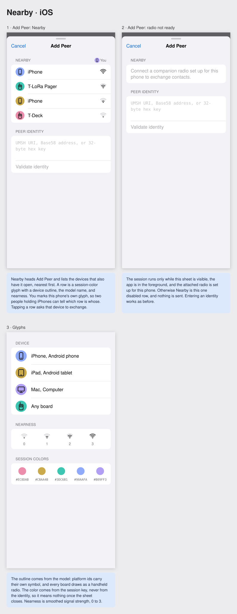
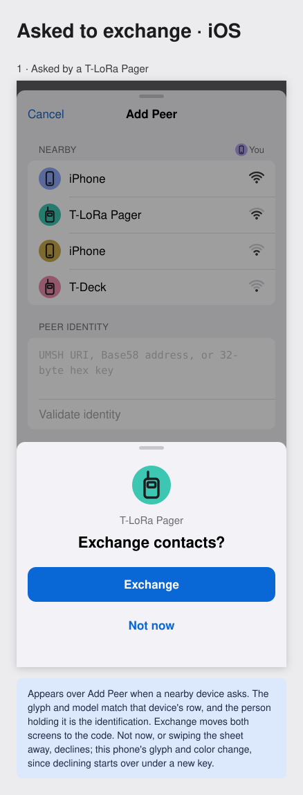
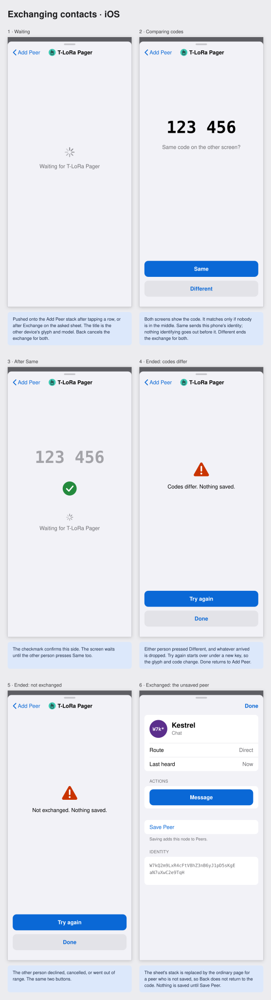

# iOS Screen Mockups

These wireframes describe hierarchy, content, actions, and state. They are not
pixel specifications. Standard iOS controls, spacing, typography, safe areas,
keyboard behavior, and accessibility sizes should be used in visual prototypes
and implementation.

## Review legend

- Text in `[brackets]` is a tappable control.
- The tab strip drawn as `[Conversations] [Network] [Settings]` predates the
  Peers/Channels split and is too narrow to redraw here. The shipping tab bar
  is **Conversations · Peers · Channels · Settings**; see
  [product structure](product-structure.md).
- `(...)` is a status or secondary label.
- `⋯` opens a menu; it is never the only route to a primary action.
- Protocol evidence is written out in detail views even when the transcript
  uses a compact symbol.

Every screen puts the normal companion-radio control in the center group of the
top iOS toolbar. `[⌁ ◫]` represents compact connected-link and battery symbols;
its full VoiceOver label names the radio and exact battery value, and its native
44-by-44-point hit region opens Radio Detail. Page titles use the navigation or
large-title region instead of sharing a full-width radio row. When attention is
required, the symbols change and a concise banner appears below the toolbar but
above the page title/content. Full-screen system sheets may cover the underlying
toolbar when radio state is irrelevant to the decision. Onboarding screens
before the Radio step are the one exception (see mockup M): no radio exists
yet, so no radio control is shown.

## A. Conversation list

```text
┌─────────────────────────────────────┐
│              [⌁̸ ◫]            [＋] │
│ ┌ Radio disconnected ────────────┐  │
│ │ ◫ Last battery 78% · 3 min ago │  │
│ │ [Connect]            [Details] │  │
│ └───────────────────────────────┘  │
│ Conversations                       │
│ [ Search conversations          ]   │
│ Pinned                              │
│ Bt/C5 Ridge Medic          9:42 AM │
│   Delivered to node                 │
│ Trail Crew                 8:15 AM │
│   Private channel · Maya: Camp… (3)│
│                                     │
│ Recent                              │
│ ▣ Eugene Room        Waiting for…  │
│   You: Checking in                  │
│ # public                    Tue     │
│   K7ABC: Repeater online            │
│                                     │
│ [Conversations] [Network] [Settings]│
└─────────────────────────────────────┘
```

`＋` opens New Message, Join Channel, and Join Room. The radio banner appears
only for an actionable degraded state. A row's status describes the last
logical message, not raw companion-link traffic.

## B. Direct conversation, connected and disconnected

```text
┌─────────────────────────────────────┐
│ ‹ Conversations    [⌁̸ ◫]      [ⓘ] │
│ ┌ Radio disconnected ─────────────┐│
│ │ ◫ Last battery 78% · 3 min ago  ││
│ │ [Connect]             [Details] ││
│ └─────────────────────────────────┘│
│ Ridge Medic                         │
│ [Bt]  Direct · PFS active           │
│ [C5]  24 min remaining              │
│        ┌ Can you hear me? ───────┐  │
│        │                     9:40│  │
│        │          Delivered to node│ │
│ ┌ Yes—near the ridge. ───────────┐ │
│ │ 9:41                            │ │
│ └─────────────────────────────────┘ │
│        ┌ On my way. ─────────────┐  │
│        │ 9:42     Sent over radio│  │
│        │    Delivery unconfirmed │  │
│        └─────────────────────────┘  │
│        ┌ Copy that. ─────────────┐  │
│        │ 9:43 Not sent · [Retry] │  │
│        └─────────────────────────┘  │
│ [ Message…                    ] [⇧̸]│
└─────────────────────────────────────┘
```

The composer remains available for drafting. While the radio is disconnected,
Send has a visibly blocked treatment but remains an explanatory action, using
the same pattern as the duty-limited state below. There is no deferred outbox.
**On my way.** was transmitted before the disconnection and shows terminal
**Delivery unconfirmed** because its active send ended without the expected
acknowledgment. **Copy that.** failed mid-send and offers an explicit **Retry**
on the message itself. Retry sends the same logical chat Message Sequence ID in
fresh packets with fresh counters, so an already-received copy is reconciled
rather than shown twice. MAC retransmissions may have occurred before the
original active send reached this terminal result. Tapping a message status
opens evidence and retry details.
`Bt` / `C5` is the peer's deterministic NodeHint avatar. A thin solid
outer ring marks active PFS in the visual mockup, while the visible **PFS
active** text remains authoritative.

### Duty-limited composer state

```text
┌─────────────────────────────────────┐
│ ‹ Conversations     [⌁ ◫]      [ⓘ] │
│ Ridge Medic                         │
│ Direct                              │
│                                     │
│                                     │
│ [ Meet at the trailhead.        ] [⇧̸]│
│ Airtime limit · Try after 4:32 PM   │
└─────────────────────────────────────┘

       ┌ Airtime limit ─────────────┐
       │ This radio cannot send the │
       │ message within its current │
       │ airtime limit.             │
       │                            │
       │ Try again after 4:32 PM.   │
       │                       [OK] │
       └────────────────────────────┘
```

The visually blocked Send control remains an explanatory activation target
rather than silently doing nothing. Its tint changes from the normal active
accent to a clearly blocked, lower-emphasis color while preserving adequate
contrast; color is reinforced by the slashed-send symbol and explanatory line.
Activating it sends no frame and opens the native alert. VoiceOver describes
**Cannot send, airtime limit, try after 4:32 PM**. The draft remains in place
and the app creates no application-level attempt to start later. The time is
shown as an estimate when it is not authoritative; if the radio cannot support
any reliable time, the alert says that and offers a later recheck instead of
inventing a timestamp. This composer state applies to direct, channel, and room
conversations. The same blocked-Send pattern covers a disconnected radio, with
**Radio disconnected · Connect to send** as the
explanation; sending always requires a connected radio, and no message is ever
queued for later transmission.

## B2. Channel conversation

```text
┌─────────────────────────────────────┐
│ ‹ Conversations    [⌁ ◫]       [ⓘ] │
│ Trail Crew                          │
│             Private channel · Multicast│
│       Everyone with the channel key │
│                                     │
│ (M) Maya                            │
│     ╭────────────────────────────╮  │
│     │ Camp is set near the creek.│  │
│     ╰────────────────────────────╯  │
│       8:13 AM                       │
│                                     │
│ (Bt/C5) Ridge Medic                 │
│     ╭───────────────────────────╮   │
│     │ I will bring extra water. │   │
│     ╰───────────────────────────╯   │
│       8:14 AM                       │
│                                     │
│                 ╭────────────────╮  │
│                 │ On my way.     │  │
│                 ╰────────────────╯  │
│            8:15 AM · Sent over radio│
│                                     │
│ [ Message Trail Crew channel… ] [↑]│
└─────────────────────────────────────┘
```

Tapping the Trail Crew row opens this familiar conversation screen directly;
it does not open setup or Channel Detail. The visible row type, persistent
**Private channel · Multicast** subtitle, audience line, and destination-specific
composer make the channel semantics clear without changing the basic chat
interaction. Send emits one multicast text message to the channel; it does not
open a recipient picker or send separate copies to recently seen participants.
`[ⓘ]` opens Channel Detail. **Sent over
radio** confirms local transmission only, because symmetric multicast provides
no receipt from every channel member. Incoming participants share one neutral
bubble style; initials, names, grouping, and spacing distinguish them without a
rainbow of sender colors. The user's outgoing bubble uses the platform accent
and trailing alignment.

## C. Peers list

```text
┌─────────────────────────────────────┐
│                  [⌁ ◫]    [scan] ⋯ │
│ Peers                               │
│ [ Search nodes               ]      │
│ [All] [People] [Sensors] [More ▾]   │
│                         [List | Map]│
│ Contacts                            │
│ Bt/C5 Ridge Medic                   │
│    Text · Seen 12 min ago           │
│                                     │
│ Recent                              │
│ ◈ Ridge Repeater                    │
│    Repeater · Regions OR-EUG        │
│    Observed 3 min ago               │
│ ◫ Creek Gauge                       │
│    Sensor · 2 resources · 18 min    │
│ ▣ Eugene Room                       │
│    Room · 7 of 20 active            │
│                                     │
│ [Conversations] [Network] [Settings]│
└─────────────────────────────────────┘
```

The filter row is horizontally adaptable and may become one filter menu at
large text sizes. Rows never call RSSI a distance. **Map** in the persistent
List/Map control opens the map without leaving the Peers tab.

## D. Peer detail

```text
┌─────────────────────────────────────┐
│ ‹ Peers            [⌁ ◫]      [Share]│
│ Peer details                        │
│                                     │
│              ╭────────╮             │
│              │   Bt   │             │
│              │   C5   │             │
│              ╰────────╯             │
│             Ridge Medic             │
│      Advertised as Alex · BtC5      │
│                                     │
│ [Message]       [Ping]      [QR code]│
│                                     │
│ IDENTITY                            │
│ Mnemonic alias      Ridge Medic [Edit]│
│ Advertised name                 Alex │
│ Public key                    [Copy] │
│ BtC5HU2XmNkfXVGRHxTmN4PkLhoRQ       │
│ MVqktxmuQWY8Jfy                     │
│                                     │
│ SECURITY                            │
│ 🛡 PFS active · 24 min remaining    │
│ [Session details]  [End PFS session]│
│                                     │
│ ACTIVITY                            │
│ Last observed              12 min ago│
│ Last ping reply        2.4 s · now  │
└─────────────────────────────────────┘
```

The local mnemonic alias is the primary label; the advertised name remains
visible and unchanged. The full public key wraps visually but is not shortened.
Show QR and Share export public identity information. Ping sends one Echo
Request, and PFS controls operate on the direct relationship represented by
this stable peer.

## D1. General node detail

```text
┌─────────────────────────────────────┐
│ ‹ Peers            [⌁ ◫]      [Share]│
│             Creek Gauge             │
│             Sensor                  │
│                                     │
│ [View data]      [Save Peer]        │
│                                     │
│ IDENTITY                            │
│ Advertised name       Creek Gauge   │
│ Signature             Valid         │
│ Identity generated    Today, 08:11  │
│ Address                             │
│ HJC9DJaaQEn88tAzbMM7BrYb            │
│ sepNEB69RK1gZiKEYCPp                 │
│                                     │
│ ACTIVITY                            │
│ Last observed         18 min ago    │
│ Learned from          Mesh traffic  │
│                                     │
│ LOCATION                            │
│ Precision             ~10 × 5 km    │
│ [View reported area]                │
│                                     │
│ [Services] [Routing] [Advanced]     │
└─────────────────────────────────────┘
```

Primary actions follow capabilities. Values the node did not provide are
omitted. The displayed address is the exact fixed-width Base58 value; the line
break is visual wrapping, not an abbreviation or part of the address. If only a
three-byte hint were known, the row would instead say **Node hint HJC9** for
this example. Its two-byte router hint would be **Router hint HJ\***.

## D2. Discover peers

```text
┌─────────────────────────────────────┐
│ Cancel           [⌁ ◫]        Stop  │
│ Discover peers                      │
│ Listening for identity traffic 0:42 │
│ ━━━━━━━━━━━━━━━━━━━╸                │
│ Silent nodes may not appear.        │
│                                     │
│ [Announce my identity…]             │
│                                     │
│ FOUND                               │
│ 👤 Maya             Text · just now │
│    Identity broadcast       [View]  │
│ ◈ Ridge Repeater      8 sec ago     │
│    Repeater · forwarded      [View] │
│ ◫ Creek Gauge        21 sec ago     │
│    Sensor · identity traffic [View] │
│                                     │
│                    [Stop discovery] │
└─────────────────────────────────────┘
```

Discovery is a bounded listening session. **Announce my identity** opens a
separate metadata-and-scope preview before transmission; it is not automatic.

## D3–D7. Manual path

[](mockups/manual-path.svg)

### D3. Peer detail: manual path held

Board 1 is the Route section of Peer Detail, scrolled into view. Hop glyphs are
the avatar shapes: a triangle for a repeater, a circle for a chat peer, a gray
hexagon for a hop known only by its hint. The summary row at the top of Peer
Detail carries a **Manual** badge beside the hop count. With no manual path
held, the section shows the learned route as it does today and offers **Set
Manual Path…** in place of the two buttons. A held direct path reads **Manual ·
Direct**, its flood row reads **Flood**, and the hop list is only the two
endpoints.

### D4. Manual path editor

Board 2 is a modal sheet in permanent edit mode: the red control removes a hop,
the grip reorders it, and the endpoints are fixed. A new path starts from the
current learned route. **Then flood** is the flood allowance past the last
repeater, Off to 15 hops. **Ping Along Path** sends a traced ping down the
unsaved draft. **Hold for** is a menu: 30 Minutes, 1 Hour (the default), 4
Hours, 12 Hours, 1 Day.

Board 3 is the same editor with every hop removed: the path is direct, the flood
row reads **Flood**, and **Save** stays enabled.

### D5. Add hop

Board 4. Choosing a row appends it and advances to the next hop with that
node's neighbors; **Done** returns to the editor. Signal figures are the
previous hop's reception of each neighbor. The footer names the path the
listing was asked through.

### D6. Router hint entry

Boards 5 and 6. When a Base58 prefix spans two router hints, the result section
lists both and **Add** waits for a choice. Both examples are real: `7Nq4` fixes
the hint `5EBD`, and `H12n` straddles `EDBC` and `EDBD`, which both render as
`H1*`.

### D7. Learned path beat the manual one

Board 7 is a half-height sheet over the conversation, whose sends read
**Delivered · flooded** while the manual path is failing.

## D8–D10. Exchanging contacts in person

The flow is specified in
[Exchanging contacts in person](../import-discovery-sharing.md#exchanging-contacts-in-person).

### D8. Nearby on Add Peer

[](mockups/nearby.svg)

Board 1 is Add Peer with four devices nearby, two of them iPhones told apart
by color. Board 2 is the same sheet while the radio is not ready. Board 3 is a
legend of device outlines, nearness levels, and sample session colors (OKLCH
L 0.75, C 0.12).

### D9. Asked to exchange

[](mockups/exchange-ask.svg)

A fixed-height sheet over Add Peer. Its glyph and model match the asker's row.

### D10. The exchange

[](mockups/exchange.svg)

Boards 1–5 are the exchange screen pushed onto the Add Peer sheet. Board 6 is
the unsaved peer page that replaces the sheet's stack once both identities
have arrived.

## E. Scanned private channel preview

```text
┌─────────────────────────────────────┐
│ Cancel   Private channel invitation │
│                                     │
│                Trail Crew           │
│             Private channel         │
│                                     │
│ This code contains a shared secret. │
│ Anyone with it can read and send on │
│ this channel.                       │
│                                     │
│ DETAILS                             │
│ Name                 Trail Crew     │
│ Region               Eugene        │
│ Suggested max hops   6              │
│ Channel key                         │
│ 5BFn8YGKJ6pZR4qV3tW7mNhD            │
│ rXsCxEaL9kUv2wAjT8bP                 │
│                                     │
│ Multicast authentication proves a  │
│ sender has the channel key; it does │
│ not uniquely authenticate a member.│
│                                     │
│              [Join channel]         │
└─────────────────────────────────────┘
```

Scanning has not yet changed local state. Metadata is presented as proposed
local configuration, and the key disclosure cannot be hidden behind a generic
information icon. The screen does not add a decorative key glyph above the
channel name; only the labeled **Channel key** field represents key material.

## F. Share identity

```text
┌─────────────────────────────────────┐
│ Done          Share identity   [↗] │
│                                     │
│       ┌─────────────────────┐       │
│       │                     │       │
│       │       QR CODE       │       │
│       │                     │       │
│       └─────────────────────┘       │
│              Darco                  │
│ HJC9DJaaQEn88tAzbMM7BrYb            │
│ sepNEB69RK1gZiKEYCPp                 │
│       Public information only       │
│                                     │
│ INCLUDED                            │
│ ✓ Display name       ✓ Signature   │
│ ✓ Capabilities       ✓ Timestamp   │
│ ○ Location           [Change…]     │
│                                     │
│          [Copy URI]   [Share…]      │
└─────────────────────────────────────┘
```

Location defaults off. Enabling it opens a precision-and-audience explanation
before regenerating the signed identity bundle.

## G. Radio detail

```text
┌─────────────────────────────────────┐
│ ‹ Settings         [⌁ ◫]            │
│ T1000-E Radio                       │
│                                     │
│ CONNECTION                          │
│ Radio                 T1000-E       │
│ Companion link        Secure BLE    │
│ Host identity         Darco          │
│ [Show host address]                  │
│                                     │
│ MESH RADIO                          │
│ Preset                US 915 · Long │
│ Radio enabled         On            │
│ Duty use              2.1%          │
│ [View expert parameters]            │
│                                     │
│ OFFLINE ASSISTANCE                  │
│ Inbound buffering     On            │
│ Delegated acks        4 peers       │
│ Channels provisioned  3             │
│ [Review security and limits]        │
│                                     │
│ MAINTENANCE                         │
│ [Firmware and diagnostics]          │
│ [Forget BLE pairing]                │
│ [Clear host provisioning]           │
└─────────────────────────────────────┘
```

Forget, clear provisioning, reset radio identity, and delete the phone identity
must never be collapsed into one Reset action.

## G2. Channel detail

```text
┌─────────────────────────────────────┐
│ ‹ Trail Crew      [⌁ ◫] [Share] ⋯ │
│ Trail Crew                         │
│ Private channel                    │
│                                    │
│ MEMBERSHIP                         │
│ Anyone with this channel key can   │
│ receive and send channel traffic.  │
│ Channel key                  [Show]│
│                                    │
│ RECENTLY SEEN PARTICIPANTS         │
│ Maya                   4 min ago   │
│ Ridge Medic           18 min ago   │
│ Not an authoritative member list.  │
│                                    │
│ ROUTING                            │
│ Region                  Eugene     │
│ Maximum flood hops      6          │
│                                    │
│ Notifications           Mentions ▸ │
│ [Show invitation QR]               │
│ [Leave channel and delete key]     │
└─────────────────────────────────────┘
```

Channels resemble group conversations, but possession of the symmetric key is
membership. Unless managed channels are later defined, the app cannot promise a
complete roster or remove one participant without rekeying everyone.

## H. Host identity takeover

```text
┌─────────────────────────────────────┐
│      Use this radio with your       │
│              identity?              │
│                                     │
│ The radio is configured for a       │
│ different phone identity.           │
│                                     │
│ REPLACED                            │
│ • queued incoming frames            │
│ • host receive filters              │
│ • delegated peer/channel keys       │
│                                     │
│ KEPT                                │
│ • radio identity                    │
│ • BLE pairing                       │
│ • frequency and radio settings      │
│                                     │
│ [Cancel]     [Replace host identity]│
└─────────────────────────────────────┘
```

The action is shown only after the app has securely attached and compared the
radio's authoritative host key. The destructive action is not preselected.

## I. Room preview and room transcript

```text
┌──────────────────┐  ┌──────────────────┐
│ ‹ Back   [⌁ ◫]   │  │ ‹ Back   [⌁ ◫]   │
│ Room preview     │  │ Conversation     │
│ Eugene Room      │  │ Eugene Room  [7] │
│ Community check- │  │ Joined as Darco  │
│ ins and notices. │  │                  │
│                  │  │ Maya joined      │
│ 7 of 20 active   │  │ ┌ Camp is set. ┐ │
│ History: 6 hours │  │ └──────────────┘ │
│ Password required│  │      ┌ On my way│ │
│                  │  │      │ Waiting… │ │
│ Handle [Darco  ] │  │      └──────────┘ │
│ Password [•••••] │  │ [Load earlier]   │
│                  │  │ [Message…    ][↑]│
│ [Join room]      │  │                  │
└──────────────────┘  └──────────────────┘
```

The waiting bubble is reconciled in place when the room returns the correlated
echo and canonical message ID.

## J. Sensor resource

```text
┌─────────────────────────────────────┐
│ ‹ Creek Gauge     [⌁ ◫]    [Refresh]│
│ Water level                         │
│                                     │
│             1.42 m                  │
│       Observed 18 minutes ago       │
│       Source: Creek Gauge           │
│                                     │
│ 1.8 ┤                               │
│ 1.6 ┤        ╭──╮                   │
│ 1.4 ┤──╮  ╭──╯  ╰──●                │
│ 1.2 ┤  ╰──╯                         │
│     └────────────────────────       │
│       06:00             12:00       │
│                                     │
│ RESOURCE                            │
│ coap-umsh://                        │
│ HJC9DJaaQEn88tAzbMM7BrYbsepNEB69   │
│ RK1gZiKEYCPp/water/level            │
│ Last request      Delivered to node │
│ Last response     18 min ago        │
│ [Request details]    [Raw value]    │
└─────────────────────────────────────┘
```

The chart is illustrative only; an actual resource view must use units and
history supplied or locally observed for that resource. Staleness remains
visible even when the value itself looks plausible.

## K. Peers map

```text
┌─────────────────────────────────────┐
│                  [⌁ ◫]    [scan] ⋯ │
│ Peers                               │
│ [ Search nodes               ]      │
│                    [List | MAP]     │
│ ┌─────────────────────────────────┐ │
│ │          Ridge Repeater ◈       │ │
│ │                                 │ │
│ │   ╭──────────────────────╮      │ │
│ │   │ Creek Gauge          │      │ │
│ │   │ reported area        │      │ │
│ │   │ ~10 × 5 km           │      │ │
│ │   ╰──────────────────────╯      │ │
│ │                        ◎ You    │ │
│ │                                 │ │
│ └─────────────────────────────────┘ │
│ Creek Gauge · Sensor                │
│ Reported 18 min ago · ~10 × 5 km    │
│                         [View node] │
│                                     │
│ [Conversations] [Network] [Settings]│
└─────────────────────────────────────┘
```

The map is the second presentation of Peers, reached by tapping **Map** in
the segmented control. It renders coarse reported locations as areas rather
than precise pins. Selecting an area shows one compact summary; **View node**
opens Node Detail. The control remains present when there are no locations so
the empty state and discovery action remain discoverable.

## L. Settings overview

```text
┌─────────────────────────────────────┐
│                 [⌁ ◫]               │
│ Settings                            │
│ IDENTITY                            │
│ [ Your identity                  › ]│
│   Darco · Stored on this device     │
│                                     │
│ RADIO                               │
│ [ T1000-E Radio                  › ]│
│   Connected · ◫ 78% · US 915 Long  │
│ [ Mesh and radio defaults        › ]│
│   Eugene · Standard routing         │
│                                     │
│ APP                                 │
│ [ Notifications                  › ]│
│ [ Privacy and permissions        › ]│
│ [ Data and diagnostics           › ]│
│ [ About UMSH                    › ]│
│                                     │
│ [Conversations] [Network] [Settings]│
└─────────────────────────────────────┘
```

Settings is a native grouped list. Identity and Radio are the first rows because
they answer “who am I?” and “how am I connected?” Selecting **Your identity**
opens the complete Base58 address and sharing/recovery controls. Selecting the
radio opens the detailed screen in mockup G. Destructive actions stay inside
their detail screens.

## M. Onboarding: welcome and identity

Onboarding screens before the Radio step omit the companion toolbar control;
there is no radio state to represent yet. The flow is resumable: leaving the
app never discards an already-created identity or completed step.

```text
┌─────────────────────────────────────┐
│                                     │
│                UMSH                 │
│    Off-grid messaging over LoRa     │
│                                     │
│  Messages travel through a nearby   │
│  UMSH radio, not cellular service.  │
│  Your identity is created on this   │
│  phone and belongs to you. The app  │
│  works without internet access.     │
│                                     │
│ [          Set Up UMSH           ]  │
│ [       Learn how it works       ]  │
└─────────────────────────────────────┘
```

**Learn how it works** opens read-only explanatory material without requesting
any permission.

## M2. Onboarding: identity choice

```text
┌─────────────────────────────────────┐
│ ‹ Welcome                           │
│ Your identity                       │
│                                     │
│ An identity is a cryptographic key  │
│ pair created on this phone. Other   │
│ people recognize you by its public  │
│ address, not by your name.          │
│                                     │
│ [ Create a new identity          › ]│
│                                     │
│ [ Restore an exported identity   › ]│
│   (Needs an identity export file    │
│    or QR set and its passphrase)    │
└─────────────────────────────────────┘
```

**Restore an exported identity** appears only when the protected identity
export format is implemented; it is hidden, not disabled, before then. There
is no third path: a radio never supplies the phone identity.

## M3. Onboarding: create identity

```text
┌─────────────────────────────────────┐
│ ‹ Identity                          │
│ Create your identity                │
│ DISPLAY NAME                        │
│ [ Darco                          ]  │
│ (Sent with your announcements.      │
│  Changeable later; not unique.)     │
│                                     │
│ [       Generate identity        ]  │
│                                     │
│ ┌ Your public address ────────────┐ │
│ │ [Dk]  Darco                     │ │
│ │ [4q]  Created just now          │ │
│ │ (complete 44-character Base58   │ │
│ │  address, wrapped)       [Copy] │ │
│ └─────────────────────────────────┘ │
│ The private key stays on this       │
│ phone. If it is lost, the mesh no   │
│ longer recognizes you as this       │
│ identity.                           │
│ [           Continue             ]  │
└─────────────────────────────────────┘
```

The address card and its explanation appear after generation. Generation is
local and immediate; no progress theater. The name may be left blank and set
later; the address, not the name, is the identity.

## M4. Onboarding: restore identity

```text
┌─────────────────────────────────────┐
│ ‹ Identity                          │
│ Restore an identity                 │
│ [ Choose export file…            ]  │
│ [ Scan export QR codes…          ]  │
│                                     │
│ EXPORT PASSPHRASE                   │
│ [ ••••••••••                     ]  │
│                                     │
│ ┌ Preview ────────────────────────┐ │
│ │ [Bt]  Ridge Medic               │ │
│ │ [C5]  Created May 2026          │ │
│ │ (complete 44-character Base58   │ │
│ │  address, wrapped)              │ │
│ └─────────────────────────────────┘ │
│ Restoring marks a fresh start for   │
│ this identity's message counters.   │
│ The exporting phone must stop       │
│ using this identity. This app       │
│ cannot verify that it was erased.   │
│ [        Restore identity        ]  │
└─────────────────────────────────────┘
```

The preview appears only after the export decrypts successfully and commits
nothing. **Restore identity** is the single named commit action. A wrong
passphrase reports failure without revealing whether the artifact was
otherwise valid. Restore never merges with an identity already on the phone;
replacing one is a separate, explicitly destructive action reached from
Identity settings, not from onboarding.

## Navigation map

```text
Onboarding
  Welcome -> Identity (Create | Restore) -> Radio -> Preset -> Ready

Conversations
  Conversation list -> Direct / Channel / Room
                    -> Message detail
                    -> Node / Channel / Room detail
  New / Scan       -> Import preview -> Confirmed destination

Peers
  List <-> Map -> Node detail -> Messages / Data / Room / Management
                              -> Manual path -> Add hop -> Router hint

Channels
  Joined / Suggested / On the radio only
                   -> Channel detail -> Share invitation / Leave
  Join / Create    -> Preview -> Joined

Settings
  Identity -> Share / Metadata / Recovery
  Radio    -> Connection / Preset / Assistance / Maintenance
  Privacy  -> Notifications / Permissions / Blocked nodes
  Data     -> Storage / Diagnostics / Versions
```

## Prototype review checklist

For each visual prototype, review:

- Can a first-time user explain the difference between identity and radio?
- Can a user start a direct message from a scan in three decisions or fewer?
- Is a channel secret visibly different from a public node identity?
- Does every delivery label say what evidence exists?
- Can a disconnected user preserve a draft and understand what will happen
  next?
- Are sensor, repeater, room, and person nodes distinguishable without color?
- Are map location precision and age honest?
- Can every destructive action name the exact state it changes?
- Does the screen remain understandable at large accessibility text sizes?
- Does the iPad layout preserve the same nouns and hierarchy as iPhone?
