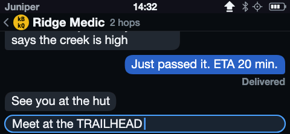
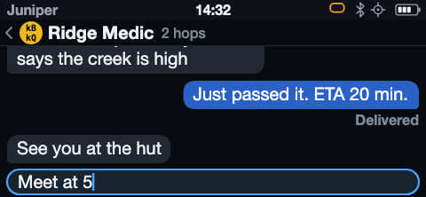
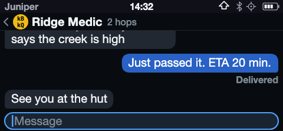
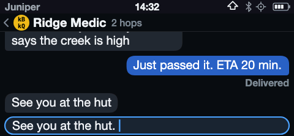
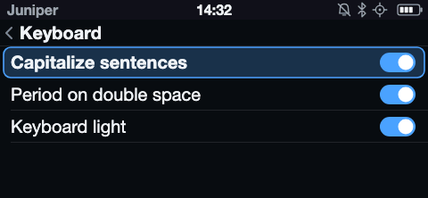
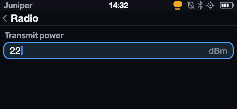
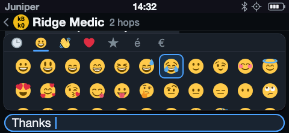
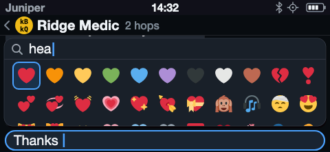
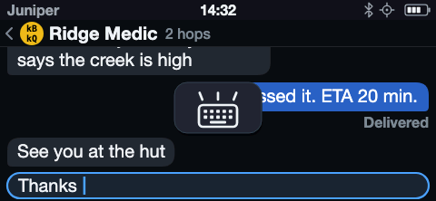
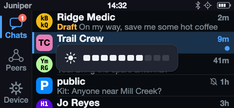

# Communicator Keyboard

A communicator's keyboard is small and has no spare keys, so two modifiers
carry everything the letter keys do not: **Shift** for capitals and **Alt** for
each key's second legend. This page defines how those modifiers behave, the
two typing aids that save keystrokes in running text, how a text field opts out
of them, and the controls reached through Alt: the character picker, the
keyboard light, and screen brightness.

Key names follow the LilyGO T-LoRa Pager: Shift is the CAP key, and Alt is the
orange key at the left of the bottom row. Every key's Alt legend is printed in
the same orange.

The screens below are from the
[T-LoRa Pager mockups](../hardware/mockups/tlora-pager-messenger.svg).

## Modifiers

Shift and Alt are each **off**, **one-shot**, or **locked**. Holding a
modifier down is separate from all three: a held modifier applies to the keys
pressed while it is down, changes no state, and shows nothing.

| From | Action | To |
|---|---|---|
| Off | Tap the modifier | One-shot |
| One-shot | Tap it again within the double-tap time | Locked |
| One-shot | Tap it again later | Off |
| One-shot | Type a key it changes | Off, after applying to that key |
| Off or one-shot | Alt, then Shift | Caps lock |
| Off or one-shot | Shift, then Alt | Symbol lock |
| Locked | Tap Shift or Alt | Off |

"Alt, then Shift" means either holding Alt while tapping Shift, or tapping Alt
and then Shift. "Shift, then Alt" is the mirror image. Tapping a modifier while
the other is locked only releases the lock; it does not arm anything.

At most one modifier is armed or locked at a time, because arming the second
always turns the pair into a lock.

**Caps lock** is a locked Shift: letters type capitals until it is released.
**Symbol lock** is a locked Alt: every key types its orange legend until it is
released, except Space, which types a space.

A one-shot modifier is used up only by a key it changes. Shift changes the
letter keys; Alt changes the letter keys and Space. Enter, Backspace, Space
under Shift, and turning the wheel leave a one-shot modifier armed.

The double-tap time is a short window, about 400 ms, shared with the
double-space period below.

## Status indicators

Modifier state shows in the status strip, left of the other status icons, in
keyboard order: Alt, then Shift.

| State | Shift | Alt |
|---|---|---|
| One-shot | Outlined arrow | Outlined orange key |
| Locked | Filled arrow with a bar | Filled orange key with a bar |

Off and held modifiers show nothing. A Shift armed by
[Capitalize sentences](#capitalize-sentences) uses the one-shot icon, since it
is a one-shot Shift and is canceled the same way.

| Caps lock | Alt, once |
|---|---|
|  |  |

### Keyboards with their own modifiers

The T-Deck's keyboard applies Shift and Sym itself and sends finished
characters. Its controller keeps the latches, by the rules above with Sym in
Alt's place, except that the two never combine: tapping one replaces the
other's state, so there is no lock made of the pair. Any key that types, Enter
and Backspace included, uses up a one-shot.

The strip shows what the keyboard reports, Sym with Alt's icons. A
[Capitalize sentences](#capitalize-sentences) Shift shows while the keyboard
reports nothing.

Shift+`$`, the key under the speaker legend, switches sounds on and off,
locked or not. Alt+C opens the [character picker](#character-picker) and
closes it again.

## Typing aids

Both aids act only inside an active text field, and only in fields that allow
them; see [Fields choose their keyboard](#fields-choose-their-keyboard).

### Capitalize sentences

When the cursor is at the start of a sentence, Shift arms itself as a one-shot.
The start of a sentence is the start of the field, or a position after `.`,
`!`, or `?` followed by a space. The rule is evaluated wherever the cursor
lands, including after the wheel moves it. Tapping Shift disarms it, and
nothing arms while a lock is on.

### Period on double space

Two spaces typed within the double-tap time become `. ` (a period and a space)
when the key pressed just before the first space was a letter. The period
then starts a sentence, so Shift arms as well.

Anything between the letter and the second space breaks the sequence. Moving
the cursor into the middle of a word with the wheel and pressing Space twice
types two spaces, because the last key pressed was not a letter. A letter typed
through Alt is a symbol, not a letter.

### Settings

**Device › Keyboard** has a switch for each aid, plus the keyboard light. A
switched-off aid is off in every field.

## Fields choose their keyboard

Each text field declares whether it allows each typing aid and which state it
opens in. Fields that take codes, names, or numbers turn the aids off, because
a capital or a period there changes the value.

| Field | Capitalize | Double-space period | Opens in |
|---|---|---|---|
| Message composer, reply | Yes | Yes | Off |
| Name: first run, local alias | Yes | No | Off |
| Find, picker filter | No | No | Off |
| Address or invitation; channel name or invitation | No | No | Off |
| Numbers: transmit power, frequency | No | No | Symbol lock |

A field's own setting can only turn an aid off; the user's switch still turns
it off everywhere. Modifier state belongs to the active field: it clears when
the field becomes inactive, and a field that opens in symbol lock sets it each
time it becomes active.

A numbers-only field in symbol lock types digits from the top row and the
minus sign from Alt+F. Space types a space.

## Character picker

**Alt+Space** in an active text field, with Alt held or one-shot, opens the
character picker. It inserts characters the keyboard does not have: emoji,
symbols, accented letters, and currency signs.

The picker covers the transcript but not the composer, so the insertion point
stays in view. Its category row starts with recently used characters.

- **Turn** walks the grid cell by cell, through every category in order; the
  category row follows.
- **Press** or **Enter** inserts the focused character at the cursor and
  closes the picker.
- **Letters** filter the picker by name, in place of the category row.
- **Backspace** removes the last filter letter, or closes the picker when there
  is none.
- **Space** toggles the keyboard light and closes the picker.

The grid overflows like any list: its last row is clipped by the picker's
edge.

| Picker | Filtered |
|---|---|
|  |  |

Filtering matches the device language's character names. The picker can offer
only characters the panel's fonts can draw.

## Keyboard light and brightness

**Alt and a double-tapped Space** toggle the keyboard light anywhere, with Alt
held or one-shot. In an active text field, the second Space is the picker's.
Elsewhere, Alt+Space alone does nothing.
A brief card shows the keyboard lit or unlit, with no words. The
**Keyboard light** switch in Device › Keyboard follows it.

**Holding Alt and turning the wheel** sets screen brightness, with a brief card
showing a sun and a level bar. This takes a held Alt only. A one-shot or locked
Alt leaves the wheel to move focus or the cursor, and releasing an Alt that
adjusted brightness does not arm it.

| Keyboard light | Brightness |
|---|---|
|  |  |
