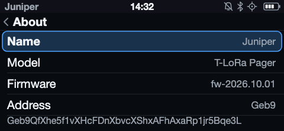
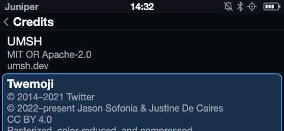

# Communicators

Communicators are self-contained UMSH clients. A phone is never part of the
critical path for setup, reading, composing, sending, status, settings, or
recovery. Their default screen should answer:

- What conversation or activity needs attention?
- Is the radio/device connected and able to send?
- What is the battery state?
- What will the primary control do now?

## Proposed information architecture

1. **Home / Inbox**—conversations, unread state, delivery summary
2. **Conversation**—message history and compose entry
3. **Nodes / Contacts**—reachable identities and details
4. **Channels**—membership and channel activity
5. **Device status**—radio, location, battery, storage, companion state
6. **Settings**—notifications, display, input, radio policy
7. **Maintenance**—pairing, diagnostics, firmware update, destructive resets

Maintenance actions should not compete visually with messaging.

## Composition

- Preserve drafts when leaving a conversation accidentally.
- Make recipient/channel and Send state visible while composing.
- Distinguish queued, transmitted, acknowledged, delivered (if the protocol
  can prove it), and failed. Never invent a stronger delivery claim.
- Provide an explicit cancel path for queued work when technically possible.

## Adding peers

Every communicator adds peers without anyone typing an address. A board
without a feature, such as NFC, leaves out the parts that use it and nothing
else changes. The screens are in the
[T-LoRa Pager mockups](../hardware/mockups/tlora-pager-messenger.svg),
Peers section.

**Add peer** heads the Peers list. It opens on **Nearby**, followed by
**Enter an address** and **Show my code**.

| | |
|---|---|
|  |  |

- **Nearby** lists the devices that also have Add peer open, nearest first.
  A device is discoverable only while this screen is open.
- **Nothing identifying is sent before both people agree.** Each row shows
  only the device's model and a color, never a name, address, hint or
  avatar. The color comes from a session key made fresh each time Add peer
  opens, so it identifies nothing afterward. The header shows this device's
  own color beside **You**, so two people holding the same model can tell
  which row is whose.
- The person is the identification. Pressing a row asks that device to
  exchange; its holder sees **Exchange contacts?** and knows who asked by
  who is standing there.

| | |
|---|---|
|  |  |

- After **Exchange**, both screens show a six-digit code. The codes match
  only if nobody is in the middle, and both people must press **Same**.
- Each device sends its address and name when its holder presses Same.
  Once both have, each shows the other on the ordinary sheet for a peer
  who is not saved: it opens on Message, and Save peer is one turn down.
  Nothing is saved until Save peer is pressed.
- **Different** on either side ends it for both, and a device whose holder
  presses Different drops whatever it received. Nothing is saved. Leaving
  the code screen cancels the same way.

| | |
|---|---|
|  |  |

**Tap.** On boards with NFC, holding two devices back to back while both
have Add peer open exchanges contacts with no code: the touch is the
agreement. Both land on the same unsaved-peer sheet. A tag carrying a
channel invitation opens Join channel, naming the card in its warning. A
phone tapping the device reads its link only while Show my code is open;
Add peer never serves it.

**Introductions.** A message whose whole body is a `umsh:n:` link is a
contact card, as an invitation is for a channel. Pressing it opens the same
unsaved-peer sheet. A saved peer's page has **Share contact**, which sends
that contact to a chosen chat.

**Names.** A peer goes by the name its latest identity gives, which
replaces whatever it was called before, the name it was saved by included.
**Alias** on a saved peer's page is what it is called here, edited where it
stands: it goes before the peer's own name everywhere, its chat and its
channel messages included, and nothing the peer advertises replaces it.
While an alias hides a different name, **Advertised name** shows that one.
Emptied, the alias goes, and the peer's own name is back.

| | |
|---|---|
|  |  |

**Enter an address** still takes a 44-character address or a `umsh:n:`
invitation, for when nobody is nearby.

## Keyboard and auxiliary controls

Use hardware navigation controls for focus and scrolling; use the keyboard for
text. Rotary encoders, trackballs, or touch can accelerate navigation but must
not be the only path when the keyboard contains usable navigation keys.

A press acts when the wheel comes back up. Holding it down instead opens
what is focused's menu where it has one: a direct chat's offers Show peer
and Delete, which asks to confirm.

Haptic or key-click feedback should be short, optional, and rate-limited. A
speaker is for notifications and media-quality tones, not confirmation for
every keystroke by default.

Modifiers, typing aids, the character picker, and the keyboard light are in
[Communicator Keyboard](communicator-keyboard.md).

## Sounds

A communicator with a speaker sounds what happens to messages. Each event has
a shape of its own, so they can be told apart from a pocket:

| Event | Shape |
|---|---|
| A direct message arrives | Four notes running up |
| A channel message arrives | Two notes falling |
| A message arrives in the conversation being read | One quiet pip |
| A message is sent | One quiet pip |
| A message is delivered | One soft, low thump |
| A message goes unconfirmed | Two low buzzes |

A muted chat's arrivals make no sound; what becomes of my own messages in it
still does. Of several events at once, only the one that matters most sounds:
a direct message, then an unconfirmed message, then a channel message.

**Device → Sounds** turns them all off, and sets their volume; changing the
volume plays a direct message's sound at each level. While they are off, the
status strip shows a bell with a slash through it. Turning sounds off leaves the haptic
motor, the screen, and the locate alert as they were; a locate alert sounds
either way.

## Locking

A communicator locks when its screen times out and a second passes without
input, or at once on a short press of the lock button, which shows the lock
screen. A dark screen is always a locked one. On the lock screen, the lock
button darkens it; while dark, it wakes to the lock screen. Holding it still
shuts down.

- **The lock screen** shows the device name, the time and date when the clock
  is known, the unread count, and one card per chat heard from since locking.
- **Unlocking** is five wheel steps down, which fill a bar, then a press within
  2 s. Turning up empties the bar; keys do nothing. Unlocking returns to
  where the user was.
- **While locked**, the screen stays lit 15 s, then fades and goes dark. Every
  message that would alert lights it again, with its tick, and restarts the
  15 s.

## Clock

**No time or date is shown anywhere until the clock is known.** Ages measured
since power-on are not read off the clock and may still show.

- **Time zones** are POSIX TZ rules the device keeps, so daylight saving needs
  no host. The list names zones ("Pacific Time"), not cities, west to east,
  with today's offset.
- **First run** asks for the zone after the radio profile, even with a GNSS
  fix: GNSS gives the time, not the zone.
- **Device › Clock** holds whether GNSS sets the time, the date and time set by
  hand, the zone, 12- or 24-hour time, and where the time last came from.
- **Every time shown** is in the offset its zone kept at that instant, so a
  message from before a daylight-saving change keeps its own hour.

## Identity and channels

**Device › Identity** is this device's own sheet, laid out as a saved peer's:
its avatar, name, and whole address, then **Name**, edited where it stands,
and **View QR code**, which opens its code alone. The code carries its
address and its signed contact (`PROP_IDENT_CONTACT`), which leaves out where
a mobile node is.

A joined channel has a sheet of its own, from its row in **Device ›
Channels** or from its chat's menu (holding the wheel on its row, as a direct
chat's opens **Show peer**):

- **Message** opens its conversation.
- **View QR code** shows its invitation, or its name for a public channel.
- **Name** is what it is called here, edited where it stands. Emptied, it goes
  by its own name again.
- **Notifications** decides whether its messages interrupt with a banner.
- **Leave**, last and confirmed, lets go of its key and its chat. Rejoining a
  private channel takes a new invitation.

## About

**Device › About** says what the device is and runs, a readout per row.

| | |
|---|---|
|  |  |

- **Name** and **Model**, as the device and its board give them.
- **Firmware** is the release tag (`fw-YYYY.MM.NN`), or the commit for a
  development build. No build date: builds are reproducible.
- **Storage** is the chats' room used of all they may keep.
- **Credits** lists the firmware's parts with their licenses: UMSH, Twemoji
  (with its copyright, its license, and that the art is rasterized,
  color-reduced, and compressed), the M PLUS fonts, and Unicode's emoji data
  and character names. Then come the Rust crates the image links, grouped by
  license. `make crate-notices` writes that list from `cargo tree`, and CI
  checks it is current.
- Entries longer than the screen take turns to pass, as a long message does.

## Optional phone integration

A communicator may optionally pair with a phone for synchronization, backup,
maps, bulk configuration, or accessibility. That connection is an enhancement,
not the communicator's primary UI and not a prerequisite for UMSH messaging.

If phone integration exists, pairing and bond management are visible
Maintenance actions. A communicator with a screen must not require users to
memorize click counts to clear trust or enter pairing. Loss of the phone or its
bond must not impair standalone communicator operation.
