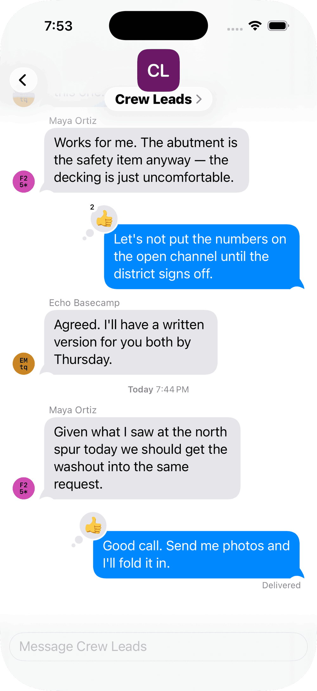
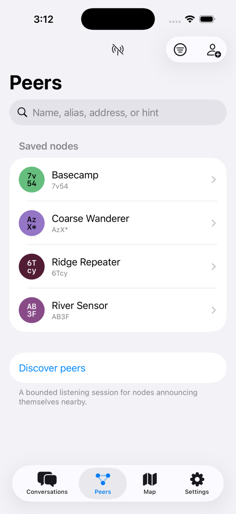
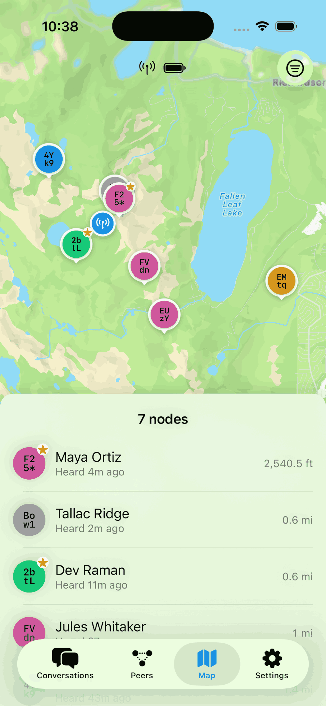

+++
title = "The app"
description = "UMSH for iPhone—how it works, what it does, and how to get into the beta."
weight = 3
+++

The UMSH app is where you actually read and write messages. It pairs with a
radio over Bluetooth and hands off everything that touches the air to that
radio, which is what lets your phone stay in your pocket while the radio does
the waiting and listening that a mesh requires.

  <figure>
    
    <figcaption>Conversations, with reactions and delivery status</figcaption>
  </figure>
  <figure>
    
    <figcaption>Contacts, each one a public key</figcaption>
  </figure>
  <figure>
    
    <figcaption>Current node locations</figcaption>
  </figure>

## What it does

**Conversations.** One-to-one messages with people you have exchanged
identities with, and group conversations on shared channels. A one-to-one
message is encrypted and authenticated against that person's own key, so a
message claiming to be from a contact really is from them. A channel message is
encrypted with the channel key, which means outsiders cannot read it or tamper
with it, though for now one member could claim to be another; per-sender
authentication for group chats is planned, and will be something you enable per
channel. Reactions are supported, and delivery status tells you whether a
message actually made it across the mesh rather than just leaving your phone.

**Forward secrecy.** When a contact opens a
[PFS session](/docs/protocol/security.html#perfect-forward-secrecy-sessions)
with you, your messages to each other go under it, and the app shows them in
violet.

**Contacts.** Every contact is a public key. You add someone by scanning a QR
code or opening a `umsh:` link they sent you, and from that moment on your
messages to them are encrypted to that key alone. There is no directory and no
account, so there is nothing to look anyone up in—which is the point.

**Your radio.** The app configures the radio it is paired with: its name, its
role, its channels, and how often it beacons. Battery, signal, and position
are visible when the hardware provides them, and a map shows the nodes you
have heard from.

**Other devices.** The app can manage a device over the mesh, once that device
lists you as an administrator. For a repeater, it can suggest which regions to
forward for, based on where the repeater is.

**Location, if you want it.** A radio with a GNSS receiver can include its
position in its identity, and the app can include the phone's own location
instead. Both are off unless you turn them on. You choose how precise the
shared area is.

Your identity lives on your phone, in the app. If you switch over to a different
companion radio, you don't need to backup your identity from the old radio
and install it on the new radio in order to not start over from scratch.

## Requirements

You need an iPhone running iOS 18 or later, and a radio to pair with. The app
does not work on its own—it is a companion to hardware, not a replacement
for it. See [supported hardware](/hardware/) for what to buy.

The app never needs an internet connection to do its job. Messages go over
radio, not over the network.

## Getting the beta

<strong>The public beta is open.</strong>
<a href="https://testflight.apple.com/join/4xsdZ8pg">Join it on TestFlight</a>.
The protocol it depends on is still moving, so expect breaking changes and
expect to reflash your radio when they land.

Feedback is most welcome, and the
<a href="https://github.com/darconeous/umsh">project's GitHub page</a> is the
place for it.

## Android

An Android app is planned. Work has not started on it.

The groundwork is in place: the protocol logic lives in a Rust core that the
iOS app already talks to through a generated interface, and the same core is
meant to serve an Android app when someone builds one.
