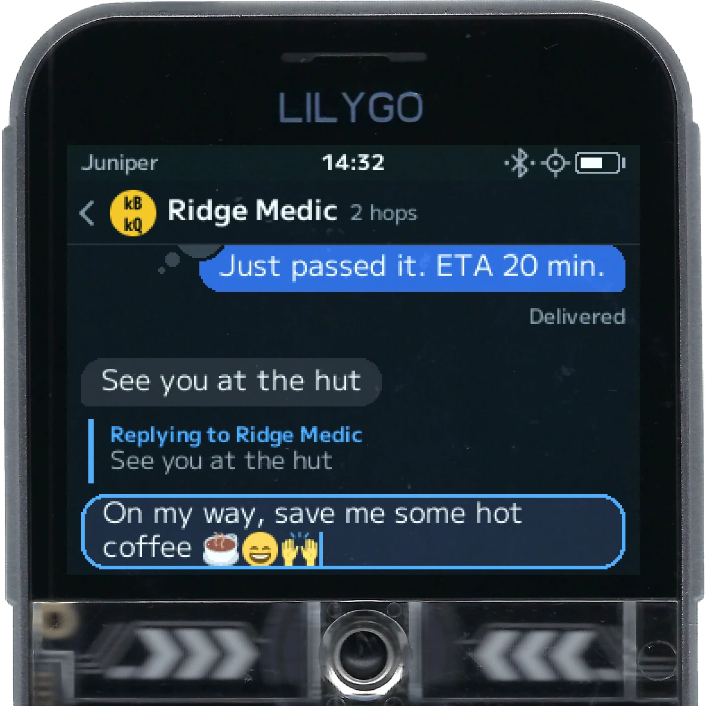
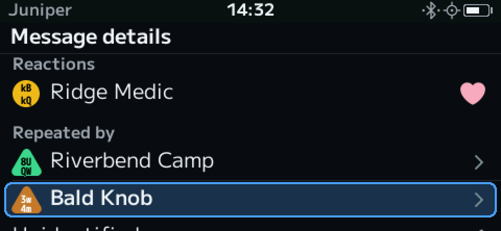
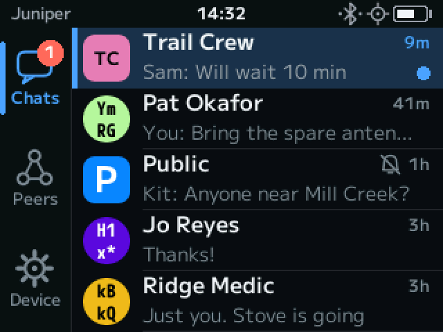
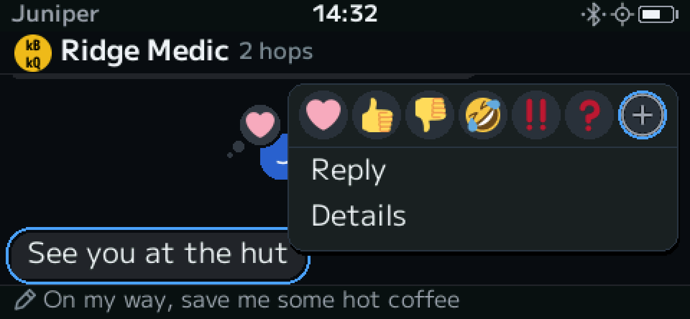
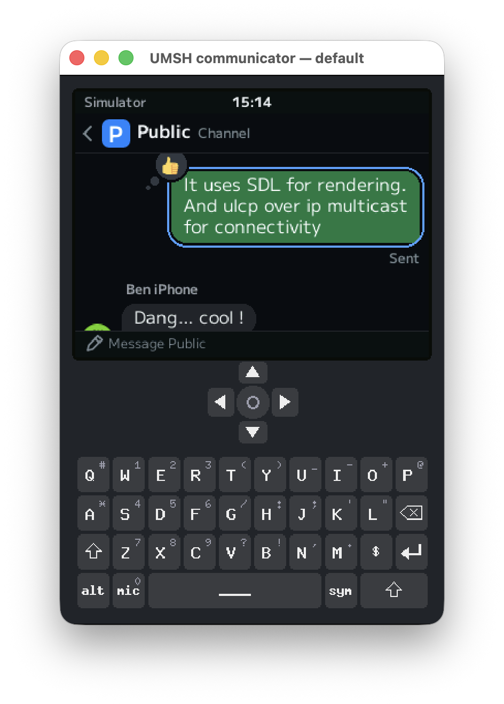
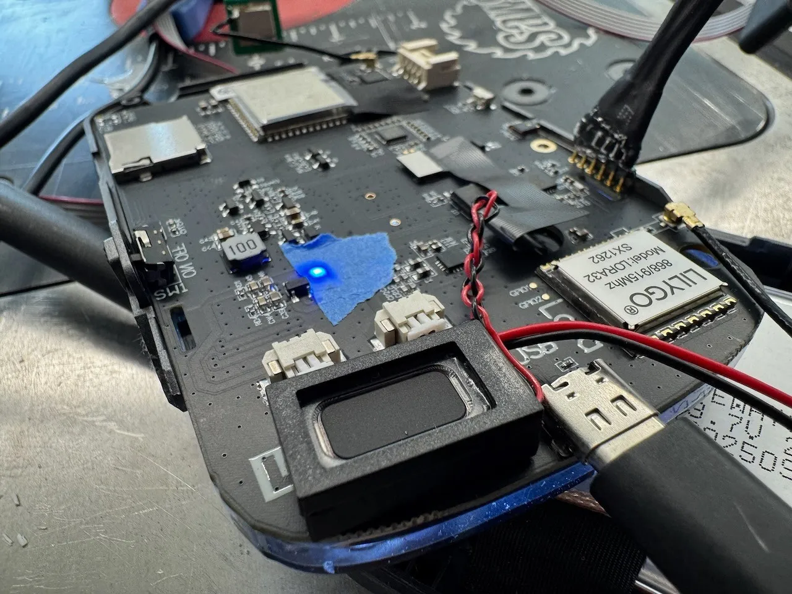
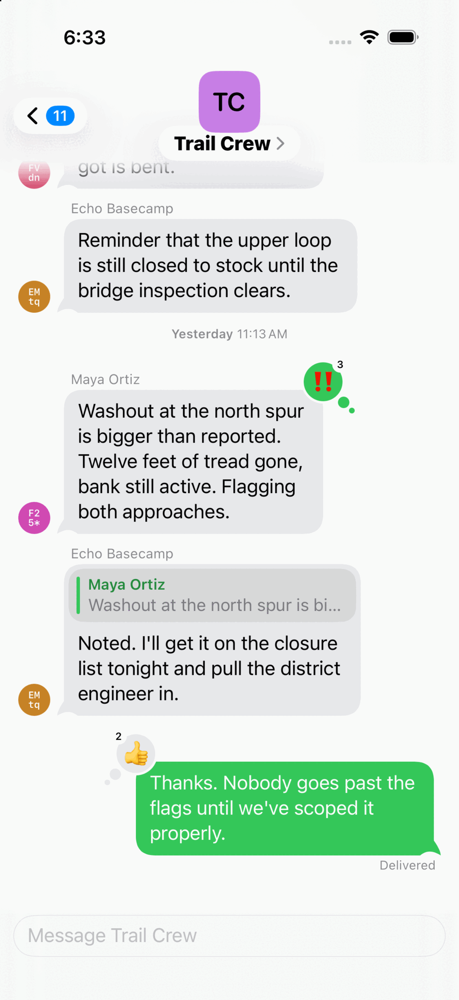
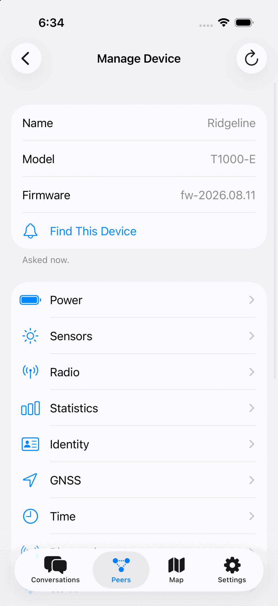

+++
title = "So much for taking a break"
description = "What has happened with UMSH over the past few months—a real mesh around Ashland, Oregon, communicator firmware for the T-LoRa Pager and T-Deck, MeshCore repeating—and where it's going."
date = 2026-11-04
draft = true

[extra]
# The social card for this post. Path is relative to static/, no leading
# slash. 1200x630; without it the post falls back to the site card.
image = "images/blog/so-much-for-taking-a-break.png"
+++

I have an admission to make: I'm not very good at marketing the stuff I make. I tend to run into my cave, hack for a while, then pop out with something new and yell out "hey look what I made" and when no one notices I shrug and move on.

UMSH feels like it deserves more publicity than I've been giving it, so in this post I want to cover what all has happened with UMSH over the past few months and where it is going.

If you're new here, [UMSH](/) is an experimental LoRa mesh protocol for long-range text messaging, similar in spirit to Meshtastic and MeshCore but built with a protocol-first approach (as opposed to a code-first approach). It uses public keys for addresses and has proper cryptography. The firmware and iOS app are open-source software. [My last post](/blog/i-made-a-thing/) has the backstory.

In that post I also said I had to stop this breakneck development for at least a month or two. There have been over 600 commits since then, so that didn't go quite as planned.

There have also been some protocol-breaking changes, so if you ended up trying the firmware or iOS app, you should update your devices and download the iOS app update.

## Real-World Deployment

Ben and I have set up 6 repeaters in and around Ashland, Oregon, and we have good coverage there now. Over the next few weeks we hope to expand coverage northward toward Medford and perhaps into Grants Pass and Rogue River. The real-world experience has been invaluable and, so far, things are working quite well.

  <figure>
    
    <figcaption>Installing a repeater</figcaption>
  </figure>

For example, once we had a few fixed repeaters up, we quickly realized a marginal direct link could actually be worse than no direct link at all.

Sometimes a node might barely hear a distant node before any repeater's copy of the same packet arrived. It would then decide that the distant node was a direct neighbor, answering it directly. But the distant node might be too far away to hear our node, so the route dies. This can happen even if a repeater right next to our node could have carried the packet without any trouble. Nodes now [learn routes from every copy of a reply and score them by signal](https://github.com/darconeous/umsh/blob/main/docs/routing-reliability-plan.md), so the good path gets a chance to win. Full support for discovering asymmetric routes is coming soon.

Managing those repeaters is easy now, too. You can manage a node over the mesh using the iOS app or using `umshctl`, without needing to be within Bluetooth range. Text messages now also show which repeaters carried them, and a ping reports the signal at each hop.

  <figure>
    
    <figcaption>Message details on the T-LoRa Pager</figcaption>
  </figure>

## Communicator Firmware

In UMSH, we call self-contained devices "communicators". Getting these up and running has been an important priority over the past few weeks, and we now have a really nice interface running on both the T-LoRa Pager and the T-Deck. Both support all the stuff people have come to expect from chat apps: emojis, reactions, etc. Scrolling is responsive, and the animations slick. And communicators can be used as companion radios, too (although your phone will be its own identity).

  <figure>
    
    <figcaption>Replying to a message on the T-Deck</figcaption>
  </figure>

  <figure>
    
    <figcaption>Reactions on the T-LoRa Pager</figcaption>
  </figure>

You can also run the communicator simulator from the command line: just do a `make run-simulator-communicator` and it should come up with a fully usable communicator that uses UMSH-over-IP-Multicast for the backend.

  <figure>
    
    <figcaption>The communicator simulator</figcaption>
  </figure>

Battery life on each of the supported devices is surprisingly good. The T-LoRa Pager has the best battery life, at around a week with GNSS and Wi-Fi turned off. A normal unmodified T-Deck Plus will get decent battery life of 2 days on standby with Wi-Fi and GPS turned off, but if you update the keyboard firmware you can stretch that out to over 4 days!

The keyboard firmware update is something I wrote primarily to address the excessive battery drain of the stock keyboard firmware. The T-Deck's keyboard is run by its own ESP32-C3, and the stock firmware never let it sleep. This [drop-in replacement](https://github.com/darconeous/umsh/blob/main/docs/tdeck-keyboard-firmware.md) puts it in a low-power state while the screen is dark, which saves about 13 mA on my T-Deck Plus. Updating the keyboard firmware is not as straightforward as updating the main ESP32-S3 on the device, but once you do you won't regret it. It is also backward compatible, so if you switch back to Meshtastic or MeshCore the keyboard will still work.

  <figure>
    
    <figcaption>Flashing the T-Deck's keyboard firmware</figcaption>
  </figure>

## MeshCore Forwarding

UMSH repeaters can now forward MeshCore traffic alongside UMSH traffic. It's an independent option from UMSH repeating, allowing supported repeaters to forward messages from either protocol, or both! It's not well tested yet, but if you'd like to give it a shot, let me know how it works out.

To be clear, UMSH and MeshCore users still can't talk to each other, but one device can now repeat for both—assuming the same LoRa settings.

## Everything Else

There is way more that I could go into, but I'll just leave you with the following:

- **More hardware.** In August I said six boards; now the [hardware page](/hardware/) lists ten, including the T-Beam Supreme and the XIAO ESP32S3 + Wio-SX1262 kit.
- **[Internet bridging](/docs/protocol/internet-bridging.html).** Radios in different places can be joined over the internet.
- **[UMSH over IP multicast](/docs/protocol/ip-multicast.html).** Nodes on the same network can reach each other with no radio involved.
- **Wi-Fi.** Several of the ESP32 boards can join Wi-Fi networks, set up from the app or, on a communicator, from the device itself.
- **[Regions](/regions/).** There is now a geographic region database, along with a map for inspecting it. It turns a position into the list of regions a repeater should accept traffic for.
- **The iOS app.** Message replies, contact exchange, notifications you can answer from your watch without opening the app, and manual route support.

  <figure>
    
    <figcaption>Replies and reactions in the iOS app</figcaption>
  </figure>
  <figure>
    
    <figcaption>Managing a node from the iOS app</figcaption>
  </figure>

## Where It's Going

The protocol is still evolving, so expect more breaking changes, even though I hope there will be few going forward. An Android app is planned. Per-sender authentication for group chats is also planned, and now that frames can be signed, a lot of the groundwork is there. The protocol work is all done, it's just a matter of getting the implementation right.

Ultimately, I'd like to drop the 'Technology Preview' label sooner rather than later, and that means building confidence that the underlying protocol is solid. To do that, I need eyeballs and real-world testing.

To be honest, it feels like we are really close! The iOS app and communicator firmware already feel better to me than their Meshtastic/MeshCore counterparts, but perhaps that's a matter of taste.

If any of this sounds interesting, check out the [protocol](/docs/protocol/), join the [iOS app beta](/app/), flash some [hardware](/hardware/), and [let me know what you think](https://github.com/darconeous/umsh/discussions). You can also just tell someone about it. As I said, I'm not very good at that part.
